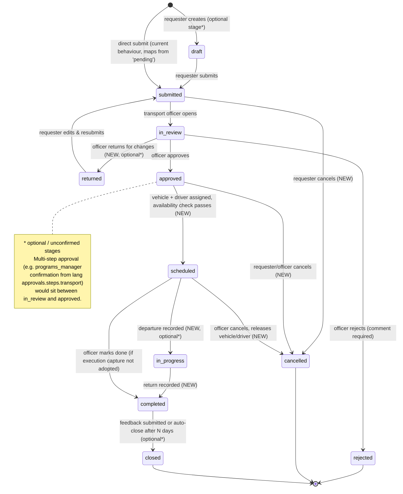

# Movement Module — Independent Architecture Proposal

> ⚠️ **SUPERSEDED (2026-11-10)** by [`movement-module-implementation-plan.md`](movement-module-implementation-plan.md).
>
> The business has since confirmed:
> - legacy `trips`/`trip_segments`/`trip_rounds` are removed outright, with no archive;
> - B and C are not authoritative and are replaced;
> - there is no branch isolation;
> - old route names and roles need not be preserved;
> - shared trips with per-section seat capacity are required.
>
> The recommendations below that keep legacy tables, preserve `role.transport.*` routes, add `App\Models` aliases, or consider branch scoping **no longer apply**. Keep this file for historical context only.

> **Status:** PROPOSAL, awaiting business and architecture approval. Nothing here is implemented.
> **Date:** 2026-11-10
> **Evidence base:** [`movement-system-discovery-audit.md`](movement-system-discovery-audit.md). Section references such as "Audit §4.2" point there.

Labels used throughout:

- **[FACT]** — verified in source.
- **[PROPOSED]** — a design recommendation.
- **[NEEDS BUSINESS DECISION]** — cannot proceed without an owner's answer.

---

## 13. Proposed independent Movement module

### 13.1 Starting point [FACT]

| Item | Today |
|---|---|
| Sub-systems | Three, unlinked: **A** legacy `trips` (+segments/rounds), **B** `transport_requests` (+trips/actions/feedback), **C** `movement_days` (+movement_trips) |
| Shared masters | `vehicles`, `drivers` |
| Code location | Spread across `App\Models`, `App\Http\Controllers\Web\Transport`, `App\Http\Controllers\Roles\Transport`, `App\Http\Controllers\Roles\TransportOfficer`, `App\Http\Controllers\Web\Reports` |
| Authorization | Role names only; 4 roles; no permissions; no branch isolation |
| Services / requests / policies | None |
| Dependencies on Agenda/Events | None in code. The only coupling is the Events → `transport` execution need routed to transport roles (`config/execution_needs.php:21`) and transport roles' edit access to monthly activities |

The Movement module already has **no runtime dependency on the Annual Agenda**. Independence therefore means consolidating ownership, not decoupling.

### 13.2 Reference pattern choice [PROPOSED]

Use the **Events/Bazaar** layout (Audit §11) as the template, not the Agenda layout. Agenda controllers live outside `app/Modules`, are over 1,300 lines, and depend on agenda-specific services.

Keep the plain Laravel style already used in the project:

- Models carry status constants.
- Form Requests handle validation.
- A small number of focused service classes handle multi-model writes.

Do not add repositories, DTOs or interfaces.

### 13.3 Ownership boundaries [PROPOSED]

| Layer | Owns | Notes |
|---|---|---|
| **1. Movement-owned** (`App\Modules\Movement`) | Vehicles, drivers, movement requests (B), driver daily schedules (C), legacy trips (A, read-only), request actions log, feedback, availability rules, conflict checks, movement reports, movement permissions seeder | All tables listed in Audit §2 |
| **2. Global application models** (stay in `App\Models`) | `User`, `Branch`, `Role`, `Setting` | Movement references them by FK only |
| **3. Shared infrastructure** (reuse, do not fork) | `AuditLog`, `NotificationService` / `InAppNotification`, Spatie permissions, `AuthServiceProvider` `Gate::before`, `layouts/app.blade.php`, `AssetVersion`, `HijriDateFormatter`, `roles.partials.dashboard-actions`. Optionally `DynamicWorkflowService` | `ConflictDetectionService` is **not** reusable: it is hard-wired to Agenda/Monthly. Movement gets its own small availability service |
| **4. External integrations** | Events execution-need `transport` (inbound); reports hub card; `AdminReportsService` counts; possibly KPI later | Integration through narrow, one-way calls. Events must not import Movement models, and Movement must not import Events models |

Things to keep global:
- Role definitions in `RolesSeeder` (Movement adds permissions additively, as Bazaar does).
- The sidebar layout file (Movement contributes one partial).

### 13.4 Ownership evaluation

| Candidate | Own in Movement? | Reason |
|---|---|---|
| Vehicles | **Yes** | Only transport uses them [FACT] |
| Drivers | **Yes** | Only transport uses them; not users [FACT] |
| Movement requests (B) | **Yes** | Core workflow |
| Trips / legs | **Yes**, one canonical leg concept going forward | Three leg tables today |
| Vehicle and driver assignments | **Yes**, as columns on the canonical leg, not a separate table | Avoids a new aggregate until required |
| Scheduling (C) | **Yes** | |
| Availability | **Yes** | Small service plus, later, an optional unavailability table |
| Approvals | **Yes**, simple status transitions on the model. Use `DynamicWorkflowService` only if multi-step approval is confirmed | [NEEDS BUSINESS DECISION] Q3 |
| Execution records | **Yes**, extra columns on the leg (actual times) | Missing today |
| Reference data (vehicle types, etc.) | **Yes**, only if business confirms the need | Absent today |
| Movement reports | **Yes** | Replace the legacy-only report |

### 13.5 Proposed folder structure [PROPOSED]

```
app/Modules/Movement/
├── Http/
│   ├── Controllers/
│   │   ├── VehicleController.php
│   │   ├── DriverController.php
│   │   ├── MovementRequestController.php      # create / list / own requests
│   │   ├── MovementRequestDecisionController.php  # officer process / assign
│   │   ├── MovementRequestFeedbackController.php
│   │   ├── MovementScheduleController.php     # driver daily movements (C)
│   │   ├── MovementCalendarController.php     # read-only grid (Phase 4)
│   │   ├── LegacyTripController.php           # read-only archive of A (Phase 8)
│   │   └── MovementReportController.php
│   └── Requests/
│       ├── StoreVehicleRequest.php, StoreDriverRequest.php
│       ├── StoreMovementRequest.php, DecideMovementRequest.php
│       └── StoreMovementScheduleRequest.php
├── Models/            # moved from App\Models with class_alias shims (see §15)
│   ├── Vehicle.php, Driver.php
│   ├── TransportRequest.php, TransportRequestTrip.php, TransportRequestAction.php, TransportRequestFeedback.php
│   ├── MovementDay.php, MovementTrip.php
│   └── Trip.php, TripSegment.php, TripRound.php     # legacy, read-only
├── Services/
│   ├── MovementAvailabilityService.php    # overlap checks for vehicle/driver
│   └── MovementRequestTransitionService.php  # status rules + action log + notifications
├── Support/
│   └── MovementStatus.php                 # status constants + labels, if not on models
└── README.md
resources/views/pages/movement/...          # matches the existing pages/* convention
routes/movement.php                         # optional; or a grouped block in web.php
database/seeders/MovementPermissionSeeder.php  # additive, Bazaar-style
```

**Notes:**
- Views stay under `resources/views/pages/…`, consistent with Events (`pages/events/bazaars`). Do not introduce a module view namespace unless the team wants one.
- A separate `routes/movement.php` requires one `require` line in `web.php` or the `RouteServiceProvider`. Both are acceptable; follow the team's preference.
- No new service provider is required. The `App\\` PSR-4 root already covers `app/Modules`.

---

## 14. Proposed lifecycle

### 14.1 Lifecycle implemented today [FACT]

**Sub-system B (requests)**

- `pending` is set by the requester on creation.
- The transport officer can set any of `in_review`, `approved`, `rejected` or `closed`, **in any order, repeatedly**.
- The requester can submit feedback (UI shows it only when `closed`; the server does not check).

**Sub-system A (trips)**

- Statuses are `scheduled`, `driver_view` and `closed`.
- The close form adds `completed`.
- Values are free strings with no guards.

**Sub-system C (movements)**

- No status. Records are create, edit and hard-delete only.

### 14.2 Missing capabilities [FACT]

- Requester edit or cancel.
- Return-for-changes.
- Vehicle assignment on requests.
- Availability and conflict checks.
- Execution capture (actual departure and return).
- Completion distinct from administrative close.
- Notifications.
- Branch-level review.
- Link from an approved request to a driver schedule.

### 14.3 Proposed lifecycle [PROPOSED — every transition needs business approval]



**Mapping existing values (non-destructive):**

| Existing value | Proposed handling |
|---|---|
| `pending` | Treat as `submitted`. Either map in code or add the constant `pending` as an alias; **no data rewrite**. |
| `in_review`, `approved`, `rejected` | Unchanged |
| `closed` | Unchanged |
| New values | Appended only |

For **Sub-system C (driver schedules)**, the proposal adds no lifecycle. A schedule is the officer's plan. When a request is scheduled, it **creates or links** a `movement_trips` leg on the driver's `movement_days` row. [NEEDS BUSINESS DECISION Q2]

---

## 15. Migration and extraction strategy

### 15.1 Principles [PROPOSED]

1. **Reuse every existing table in place.** No table replacement and no renames, because production data and historical rows must stay readable. Renaming `transport_requests` to `movement_requests` would buy cosmetic consistency at real risk, so it is not recommended.
2. **Every schema change is additive and nullable.** New columns, new indexes and new tables only. No migration dated before `2026_09_10_000100_add_event_applicability_to_target_groups_table` is ever edited.
3. **Relocate models with compatibility shims.**
   - Move each class to `App\Modules\Movement\Models\…`.
   - Keep `App\Models\Vehicle` (etc.) as a `class_alias`, or as a thin subclass, for one release, so that `AdminReportsService`, `Branch::vehicles()`, `User::tripsCreated()` and seeders keep working.
   - The project already uses `class_alias` in `AppServiceProvider.php:39`.
   - Morph types are not used by transport models, so no polymorphic type strings are at risk. [FACT: no `morphTo` in transport models]
4. **Preserve route names and URIs.**
   - Keep `role.transport.*` names and `/dashboard/transport/*` URIs working, pointing at the new controllers.
   - If new names are introduced (e.g. `movement.*`), keep the old names as aliases or redirects.
   - Blade views and bookmarks reference the old names.
5. **Preserve roles; add permissions.**
   - Keep `transport_officer` and `movement_*`.
   - Introduce `movement.*` permissions through an additive `MovementPermissionSeeder`, modelled on `BazaarRolePermissionSeeder`.
   - Switch route middleware from `role:X` to `role_or_permission:X|movement.perm` so that existing role holders keep access and super_admin gains it via permission.
   - Never revoke.
6. **Keep reports compatible.**
   - `AdminReportsService` `Trip::count()` stays valid.
   - The new movement report adds sections; it does not remove the legacy trips list until business approves.
7. **Historical records.** Legacy A data stays in place as a **read-only archive**. No data migration into B or C unless business explicitly asks, because the shapes differ (segments vs rounds) and the mapping is ambiguous.
8. **Do not schedule `MovementSeeder` for production.** Remove it from `DatabaseSeeder`, or guard it behind an environment check, in a dedicated, reviewed change (Audit T-09).

### 15.2 Candidate additive schema changes (future, not created now) [PROPOSED]

| Change | Purpose | Risk |
|---|---|---|
| `transport_request_trips` + `starts_at`/`ends_at` datetime nullable (backfilled from date + time where possible) | Overlap detection, overnight support | Backfill script must be idempotent and leave originals intact |
| `movement_trips` + `starts_at`/`ends_at` nullable, + `transport_request_trip_id` nullable FK nullOnDelete | Link request → schedule, conflicts | none to existing rows |
| `transport_requests` + `branch_id` index; + `cancelled_at`, `cancelled_by` nullable; + `submitted_at`, `decided_at` | Lifecycle, reporting | none |
| Execution columns: `actual_departure_at`, `actual_return_at`, `odometer_start/end` (optional) | Execution capture | [NEEDS BUSINESS DECISION] |
| `vehicles` + `vehicle_type`, `capacity` nullable; unique on `plate_no` **only after a data-quality check** | Assignment by need (bus/car from Events) | Duplicate plates may already exist [UNVERIFIABLE] |
| `drivers` + `user_id` nullable unique FK | Driver self-service | [NEEDS BUSINESS DECISION Q5] |
| `movement_unavailabilities` (resource_type, resource_id, starts_at, ends_at, reason) | Maintenance and leave blocks | New table; optional |
| Change cascading FKs to `restrict`/`nullOnDelete` **or** add `SoftDeletes` to `User`/`Branch` | Stop history loss (Audit T-01, T-02) | Cross-cutting. Must be decided at application level, not inside Movement. Altering FKs in a new migration is permitted, but the change needs DBA review |

### 15.3 What stays backward-compatible throughout
- All 35 existing routes (names and URIs).
- All 11 tables and their columns.
- The 4 role keys.
- The `config/execution_needs.php` `transport` decision roles.
- `AdminReportsService` keys `vehicles` and `trips`.
- Lang keys under `app.roles.transport.*` (new keys may be added).

---

## 16. Phased implementation roadmap

Phases were reordered from the suggested list based on dependencies:

- Permissions and branch decisions gate everything, so they move earlier.
- The calendar depends on canonical datetimes and conflict rules, so it moves later.

| Phase | Title |
|---|---|
| 0 | Discovery and architecture approval |
| 1 | Module foundation and safety fixes |
| 2 | Permissions and branch scope |
| 3 | Vehicles and drivers |
| 4 | Movement requests and approvals |
| 5 | Scheduling, availability and conflict prevention |
| 6 | Calendar |
| 7 | Execution and completion |
| 8 | Notifications, reports and dashboards |
| 9 | Legacy consolidation, cleanup and documentation |

### Phase 0 — Discovery and architecture approval
- **Scope:** Answer the open questions (§Business decisions). Collect production row counts for all 11 tables. Confirm super_admin behaviour on `role:` routes in staging.
- **Files:** none (docs only).
- **DB impact:** read-only queries by the DBA.
- **Risks:** proceeding without knowing which sub-system holds live data.
- **Acceptance:** signed-off answers to Q1–Q11; row-count table appended to the audit.

### Phase 1 — Module foundation and safety fixes
- **Scope:**
  - Create `app/Modules/Movement`.
  - Move the 11 models with `App\Models\*` aliases.
  - Add status constants mirroring current values.
  - Add `SoftDeletes` to `Vehicle`, `Driver` and `Trip` (columns already exist).
  - Remove or guard `MovementSeeder` in `DatabaseSeeder`.
  - Add the missing `pending` translation.
  - Fix `process` nulling `driver_id`.
  - Add a server-side status guard on feedback.
- **Files:**
  - `app/Models/{Vehicle,Driver,Trip,…}.php` (become aliases)
  - `app/Modules/Movement/Models/*`
  - `app/Providers/AppServiceProvider.php`
  - `database/seeders/DatabaseSeeder.php`
  - `resources/lang/{ar,en}/app.php`
  - `TransportRequestsController.php`
- **Dependencies:** Phase 0.
- **DB impact:** none.
- **Risks:** missed class references (mitigated by aliases + a grep audit); `SoftDeletes` hiding rows (all `deleted_at` are NULL today [INFERRED]).
- **Acceptance:** all existing routes return the same responses; feature tests added for each existing route (none exist today).
- **Backward-compatible:** class names, routes, tables.

### Phase 2 — Permissions and branch scope
- **Scope:**
  - `MovementPermissionSeeder` (additive) with `movement.view`, `movement.request.create`, `movement.request.decide`, `movement.vehicles.manage`, `movement.drivers.manage`, `movement.schedule.manage`, `movement.schedule.delete`, `movement.reports.view` (names are proposals).
  - Grant them to the existing roles to reproduce today's matrix exactly.
  - Switch middleware to `role_or_permission:`.
  - Gate Blade buttons with `@can`.
  - Fix sidebar visibility.
  - Add the requests page to the sidebar.
  - Implement branch scoping **only if** business confirms (Q4).
- **Files:** `routes/web.php:391-424`, `layouts/app.blade.php:63-66,234-239`, movement views, the new seeder, `CompleteRolePermissionSeeder` (optional call).
- **Dependencies:** Phase 1; Q4, Q6, Q7, Q8.
- **DB impact:** inserts into `permissions` and `role_has_permissions` only.
- **Risks:** accidentally widening or narrowing access. Mitigate with an authorization test matrix per role.
- **Acceptance:** an automated test asserts the Audit §5.2 matrix, with documented intentional changes only.
- **Backward-compatible:** every current role keeps its current access.

### Phase 3 — Vehicles and drivers
- **Scope:**
  - Form Requests with `Rule::in` statuses.
  - Remove the duplicate create forms (keep the index inline form *or* the create page, not both).
  - Show translated status labels.
  - Paginate lists.
  - Optional `vehicle_type`/`capacity` and driver `user_id` (Q5).
  - Exclude inactive or maintenance resources from assignment dropdowns.
- **Files:** `Vehicle/DriverController`, `pages/transport/{vehicles,drivers}/*`.
- **DB impact:** optional additive columns.
- **Risks:** existing rows with off-list statuses. Run a data check before enforcing `Rule::in` on update.
- **Acceptance:** CRUD parity; invalid statuses rejected; an audit log entry per change (`AuditLog`, `module='movement'`).

### Phase 4 — Movement requests and approvals
- **Scope:**
  - `MovementRequestTransitionService` with an allowed-transition table (§14.3, as approved).
  - Requester cancel and edit while `submitted`/`returned`.
  - Comment required on reject and return.
  - Vehicle assignment on the request leg.
  - Multi-leg support if desired (the schema already allows it).
  - Use `DynamicWorkflowService` only if Q3 confirms multi-step approval.
- **Files:** `TransportRequestsController` split into Request/Decision/Feedback controllers; `roles/transport/requests/index.blade.php` split into list, show and form views.
- **DB impact:** additive lifecycle timestamp columns.
- **Risks:** legacy `pending` rows; reopened closed requests in history. Map them, do not rewrite.
- **Acceptance:** illegal transitions return 422/403; every transition writes `transport_request_actions`.
- **Backward-compatible:** existing statuses display correctly; existing action log is intact.

### Phase 5 — Scheduling, availability and conflict prevention
- **Scope:**
  - `starts_at`/`ends_at` on legs, with an idempotent backfill.
  - `MovementAvailabilityService` with overlap checks per vehicle and per driver across B and C (and A if it remains active).
  - Validate `return > departure`.
  - Link an approved request leg to a `movement_trips` row.
  - Optional unavailability table.
- **Files:** `MovementsController`, request decision controller, the new service, `movements/form.blade.php` + JS.
- **DB impact:** additive columns, indexes `(vehicle_id, starts_at)` and `(driver_id via day, starts_at)`.
- **Risks:**
  - Existing overlapping data. Report it; do not block edits of historical rows unless they are changed.
  - The delete-and-recreate of `movement_trips` must become update-in-place to keep links stable (Audit T-14).
- **Acceptance:** creating a double-booked vehicle or driver fails with a clear Arabic message; historical rows remain viewable.

### Phase 6 — Calendar
- **Scope:** read-only month/week grid (server-rendered, reusing the Monthly/Bazaar grid approach); filters by driver, vehicle and branch; links into requests and schedules.
- **Dependencies:** Phase 5 datetimes.
- **DB impact:** none.
- **Risks:** performance on large ranges. Bound queries by date range and eager-load.
- **Acceptance:** the calendar matches list data for a sampled month; respects Phase 2 permissions.

### Phase 7 — Execution and completion
- **Scope:** record actual departure and return (and optionally odometer); `completed` distinct from `closed`; feedback after completion.
- **Dependencies:** Q-decisions on execution capture.
- **DB impact:** additive columns.
- **Acceptance:** completed trips show planned vs actual; feedback allowed only after completion.

### Phase 8 — Notifications, reports and dashboards
- **Scope:**
  - In-app notifications via `NotificationService` (submitted → officer; decision → requester; scheduled → requester).
  - A new movement report covering requests by status and branch, vehicle utilisation and driver load, with CSV export.
  - Officer dashboard reachable from navigation, with the reports card fixed.
  - Optional KPI hooks.
- **Files:** `TransportReportsController`, `pages/reports/transport.blade.php`, `ReportsController.php:17`, `AdminReportsService` (additive keys only).
- **Risks:** changing existing report numbers. The legacy trips section stays until approval.
- **Acceptance:** report totals reconcile with table counts; existing `AdminReportsService` keys unchanged.

### Phase 9 — Legacy consolidation, cleanup and documentation
- **Scope:**
  - Decide the fate of sub-system A (Q11): read-only archive page, or a documented one-off copy into C.
  - Remove dead routes (`segments.update`, `rounds.update`, unused `*.create`) **only after** a deprecation period with redirects.
  - Remove the `App\Models` aliases after one release with no references.
  - Write the module README.
  - Update `config/site_role_guide.php`.
- **DB impact:** none by default; any data copy is additive and reversible.
- **Acceptance:** no references to removed routes; docs updated; the test suite covers the module.

---

## Business decisions required before implementation

| # | Question | Blocks |
|---|---|---|
| Q1 | Which of A, B and C hold live production data, and which is the system of record? | Phases 1, 5, 9 |
| Q2 | Is movement request-driven, schedule-driven, or both (requests feed schedules)? | Phases 4, 5 |
| Q3 | Who approves requests, and is multi-step approval (programs_manager confirmation) required? | Phase 4 |
| Q4 | Are vehicles, drivers and requests branch-scoped? Who sees other branches? | Phase 2 |
| Q5 | Should drivers be system users? | Phases 3, 7 |
| Q6 | Should super_admin manage the fleet (currently likely blocked)? | Phase 2 |
| Q7 | Should transport and movement roles keep monthly-activity edit rights? | Phase 2 (Events side) |
| Q8 | What is the exact split between `transport_officer`, `movement_manager`, `movement_editor` and `movement_viewer`? | Phase 2 |
| Q9 | Should an Events "transport" need generate a movement request automatically? | Phase 8 integration |
| Q10 | Are fuel, maintenance, licences, insurance and violations in scope? | Out of the current roadmap unless approved |
| Q11 | What happens to legacy `trips` / `trip_segments` / `trip_rounds`? | Phase 9 |
| Q12 | Should users and branches be soft-deleted application-wide, to stop cascade loss? | Cross-cutting; recommended before Phase 1 |

## Critical risks summary
1. **History loss via hard deletes + cascade FKs** (Audit T-01, T-02). This exists today, independent of the new module.
2. **Demo seeder in the default seeding path** (T-09).
3. **Three competing data models.** Building the new module on the wrong one wastes effort; Q1 must come first.
4. **Authorization regression** during the role → permission switch. Mitigate with a test matrix before any change.
