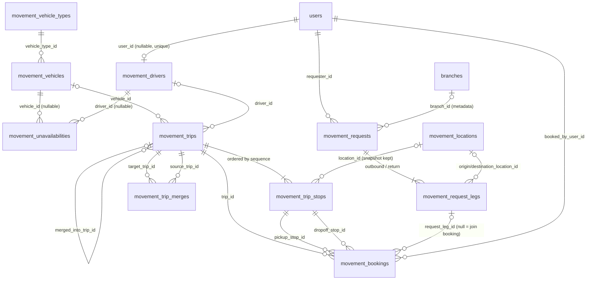
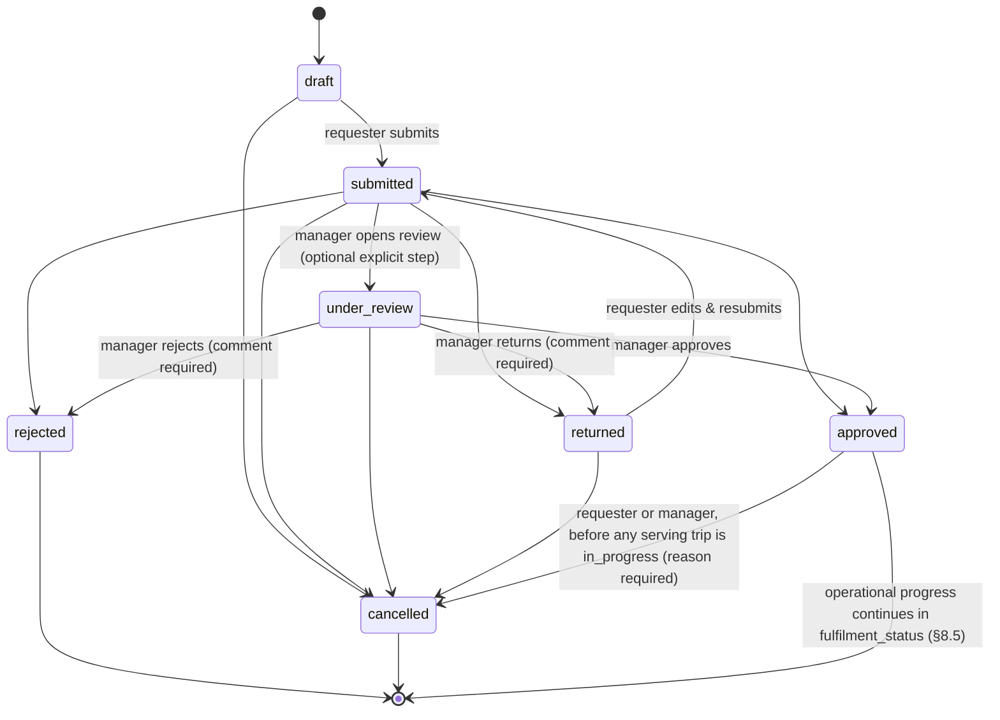
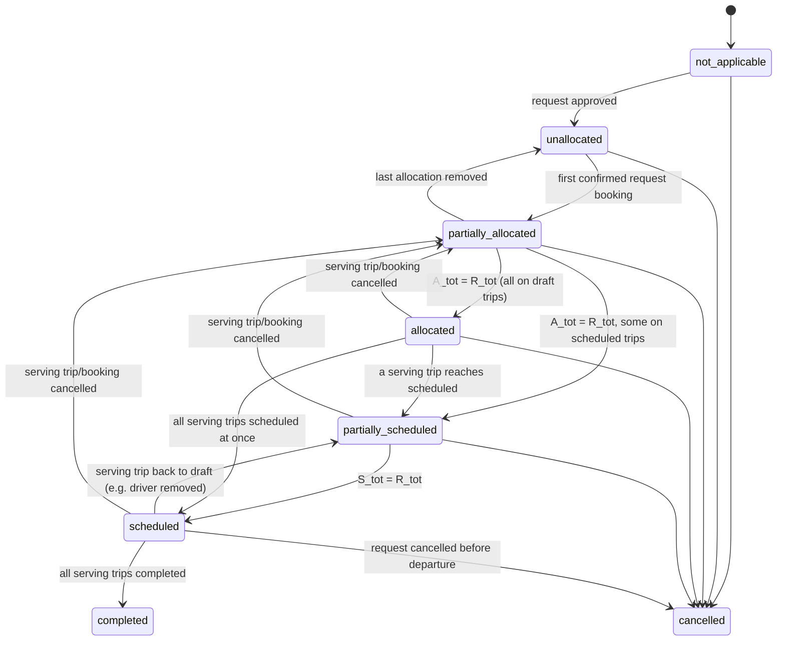
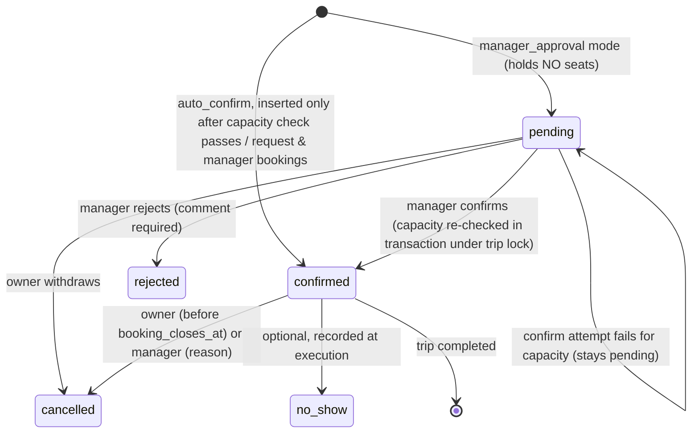
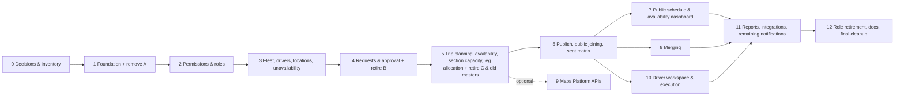

# Movement & Fleet Management Module — Implementation Plan

> **Status:** Implementation-ready plan, pending sign-off on the open decisions in §22. Nothing in this document has been implemented.
> **Date:** 2026-11-10
> **Supersedes:** [`movement-module-architecture-proposal.md`](movement-module-architecture-proposal.md). That proposal assumed legacy data must be preserved and the existing roles and routes kept. The business has now overruled both assumptions.
> **Evidence base:** [`movement-system-discovery-audit.md`](movement-system-discovery-audit.md) ("Audit §n"), plus a fresh read-only inspection of the repository for this plan.
> **Revision 2 (2026-11-10):** incorporates the 16-point technical review. The changes:
> - capacity is checked from Phase 5;
> - request legs are protected from over-allocation across trips;
> - the request fulfilment model is defined;
> - booking semantics are made unambiguous;
> - merge reversal, merge locking and the merge-history migration policy are specified;
> - paired-trip reservations are defined;
> - permission and visibility rules are corrected;
> - the migration rollback policy is data-safe;
> - legacy A backup and archive are separated;
> - imported-status handling is safe;
> - D11 is split into D11 and D19;
> - booking idempotency is defined;
> - operational consistency rules are added;
> - the Phase 1 scope is made explicit.
>
> The confirmed requirements R1–R15 are unchanged.

## Labels

| Label | Meaning |
|---|---|
| **CONFIRMED** | Explicitly approved by the business (the requirements brief) |
| **VERIFIED** | Confirmed in source code (file:line given) |
| **PROPOSED** | Architectural recommendation from this plan |
| **DECISION REQUIRED** | Needs business approval before the related phase starts |
| **UNVERIFIABLE** | Cannot be established from the repository alone |

---

## 1. Executive summary

The organisation needs one organisation-wide transport service with these capabilities:

- The **Movement Department Manager** (`movement_manager`) registers the fleet and the drivers.
- Branch Relations Officers and Branch Managers request trips.
- The manager approves requests and plans real routes with ordered stops.
- Any staff member can see the published schedule and **reserve seats on a shared trip**. Capacity is enforced **per route section**, not per trip.
- The manager can **merge** compatible trips onto one vehicle.

**Decision:**

- Build `App\Modules\Movement` as a new module with its own normalised schema, prefixed `movement_*`.
- **Retire all three existing transport sub-systems:**
  - **A** — the old `trips`, `trip_segments`, `trip_rounds`. It was never used and is removed outright.
  - **B** — transport requests.
  - **C** — driver daily movements.
- Nothing from B or C fits the shared-trip and section-capacity model well enough to keep its tables. From the existing code the module keeps only:
  - the requirement intent;
  - the dynamic-row form pattern;
  - the shared infrastructure: Spatie permissions, `NotificationService`, `AuditLog`, `GoogleMaps` helper, layout and asset pipeline.

**Core design in one line:**

> A **Request** expresses demand → the manager plans a **Trip** (one vehicle, one driver, ordered **Stops**) → demand is served by **Bookings** that occupy a contiguous range of route **Sections** (pickup stop → drop-off stop) → capacity holds when, for every Section, the passengers on it ≤ trip seat capacity.

**Delivery:** 13 phases (§19), ordered by dependency.

- Availability, conflict prevention and the essential section-capacity check move **into** the assignment and allocation phase (5). The suggested order put them after, but trips cannot be assigned, and request legs cannot be allocated, safely without them.
- Google Maps Platform APIs are an **optional** later phase. Phase 5 works with keyless Google Maps URLs and the existing embed helper.

---

## 2. Confirmed business requirements

| # | Requirement | Label |
|---|---|---|
| R1 | Movement is a new operational system. No prior system was adopted | CONFIRMED |
| R2 | Legacy A (`trips`, `trip_segments`, `trip_rounds`) is fully removed: no archive, no data migration, no backward compatibility | CONFIRMED |
| R3 | B and C are not authoritative. Reuse only what genuinely fits | CONFIRMED |
| R4 | Standalone module `App\Modules\Movement` owning models, controllers, requests, services, routes, permissions, views, assets, translations, reports and lifecycle | CONFIRMED |
| R5 | **No branch isolation.** Vehicles, drivers, requests and schedule are organisation-wide. Branch, event and department are metadata only | CONFIRMED |
| R6 | The Movement Department Manager manages vehicles and drivers, reviews and approves requests, plans routes, assigns resources, publishes and merges trips | CONFIRMED |
| R7 | New trip requests: Branch Relations Officers and Branch Managers, configurable later for more roles or specific users | CONFIRMED |
| R8 | All authenticated users: view the published schedule, fleet availability, vehicle types and capacities, the available-driver count; request to join a published trip | CONFIRMED |
| R9 | Round trips with their own return details | CONFIRMED |
| R10 | Route planning with ordered stops, planned times, duration and distance, and Google Maps support | CONFIRMED |
| R11 | Shared trips with **per-section capacity**, pickup before drop-off, safe under concurrency | CONFIRMED |
| R12 | Manager-controlled trip merging with audit, notifications and reversal; never automatic | CONFIRMED |
| R13 | Drivers can be linked to system users through a controlled process; no automatic account creation | CONFIRMED |
| R14 | Jordan local time, trips crossing midnight, full datetimes | CONFIRMED |
| R15 | The Movement Manager is the primary approver. Any additional stage is optional | CONFIRMED |

---

## 3. Existing system findings (re-verified for this plan)

| Finding | Evidence | Label |
|---|---|---|
| Three unlinked transport sub-systems (A, B, C) plus shared `vehicles` and `drivers` | Audit §0, §2 | VERIFIED |
| `vehicles.branch_id` is NOT NULL with cascade, so vehicles are branch-owned, which contradicts R5 | `2024_02_01_012000_create_vehicles_table.php:16` | VERIFIED |
| `drivers` has no `user_id`, licence, type or capacity fields | `2024_02_01_012100…:11-18` | VERIFIED |
| Laravel 8 without `doctrine/dbal`, so `->change()` column modifications are unavailable | `composer.json:11` (`laravel/framework ^8.75`), no `doctrine/dbal` | VERIFIED |
| Default DB connection is `mysql`; the test sqlite lines are commented out | `config/database.php:18`, `phpunit.xml:24-25` | VERIFIED |
| `config/app.php` timezone is **hard-coded `UTC`**. No Jordan conversion layer exists; notifications render in `config('app.timezone')` | `config/app.php:71`, `layouts/app/partials/notifications-menu.blade.php:86` | VERIFIED |
| Role keys: `movement_manager` (مدير الحركة), `relations_officer` (مسؤول العلاقات بالفرع), `supervisor` (**رئيس فرع**, the Branch Manager). There is **no `branch_manager` key** | `RolesSeeder.php:74-98`, `config/site_role_guide.php:8-9` | VERIFIED |
| Legacy roles `transport_officer`, `movement_editor`, `movement_viewer` exist; the movement roles hold only `agenda.view` | `RolesSeeder.php:90,94-95,257,264-266` | VERIFIED |
| Per-user permission grants **and per-user denials** are already supported | `User.php:46-55` (`deniedPermissions`, overridden `hasPermissionTo`), `UsersController.php:162-166` | VERIFIED |
| `Gate::before` grants super_admin everything; Spatie `role:` middleware likely bypasses it | `AuthServiceProvider.php:22-28`; Audit §5.2 | VERIFIED / INFERRED |
| Module-owned permission seeder precedent: additive `updateOrCreate` + `givePermissionTo`, explicit super_admin grant | `database/seeders/BazaarRolePermissionSeeder.php` | VERIFIED |
| Module convention: controllers in `app/Modules/Events/Http/Controllers/<Area>`, requests in `Http/Requests/<Area>`, models with `STATUS_*` constants, views in `resources/views/pages/events/<area>`, routes grouped in `routes/web.php` | `routes/web.php:19-23,259`, `Bazaar.php:11-20` | VERIFIED |
| Module translation files exist per area (`ramadan_iftars.php` in ar+en; `bazaars.php` in ar only) | `resources/lang/{ar,en}/` | VERIFIED |
| In-app notification API: `NotificationService::notifyUsers(Collection $users, string $type, string $title, ?string $message, ?string $actionUrl, array $meta)` | `app/Services/NotificationService.php:22` | VERIFIED |
| Audit log: `AuditLog(user_id, action, module, entity_type, entity_id, old_values, new_values)` with index `(entity_type, entity_id)`. The `TrackUserOperations` middleware also writes to it | `AuditLog.php:12-25`, `2024_02_01_012600…:22`, `Kernel.php:41,48` | VERIFIED |
| Row-locking precedent: `lockForUpdate()` inside transactions | `ActivityEvaluationService.php:34`, `RamadanGuidanceAdminController.php:16` | VERIFIED |
| Calendars elsewhere are **server-rendered Blade grids**; date inputs use `flatpickr`; no JS calendar library is installed | `MonthlyActivityCalendarController`, `pages/events/ramadan/calendar.blade.php`, `public/assets/js/agenda-events-index.js:393` | VERIFIED |
| Google Maps support is **keyless**: Maps URLs (`/maps/dir/?api=1&destination=`), legacy `maps.google.com/maps?q=…&output=embed`, coordinate extraction from pasted Maps links. No API key is configured anywhere | `app/Support/GoogleMaps.php:7-80`; no `GOOGLE*` keys in `config/` | VERIFIED |
| Asset pipeline minifies every `public/assets/**/*.js\|css` to `.min.*`; pages load them via `AssetVersion::url()` | `webpack.mix.js:35-46`, `pages/transport/movements/form.blade.php:97` | VERIFIED |
| Events "transport" execution need stores `vehicles_count`, `vehicle_type (bus\|car)`, `passengers_count`, `trip_direction (go_only\|round_trip\|return_only)`, `start_from`, `start_to` as JSON. Decision roles `transport_officer`, `movement_manager` | `MonthlyActivityPlanningController.php:321-327,2271-2279`, `config/execution_needs.php:21` | VERIFIED |
| `resources/lang/{ar,en}/green-wheelz-movements.php` describe a different domain (supply/collection movements) and are referenced nowhere in code | grep: no references | VERIFIED — **out of scope, do not touch** |
| Production row counts, and who holds `transport_officer` / `movement_editor` / `movement_viewer` in production | — | UNVERIFIABLE |
| Local toolchain: the default `php` CLI is 7.4, but the codebase needs PHP 8 (`match` in `config/site_role_guide.php:175`), so use `php8.2`. `vendor/spatie` is absent locally, and `pdo_sqlite` is not installed | `php -v`, `php8.2 artisan --version` → 8.83.29 | VERIFIED (local only) |
| Test convention: 52 feature tests use `RefreshDatabase` on the **default connection** (`phpunit.xml` keeps the sqlite override commented out). Running them locally would wipe the configured MySQL database. DB-free tests (route contracts, pure unit tests) are safe to run | `phpunit.xml:24-25`, `tests/Feature/*` | VERIFIED |

---

## 4. Reuse, replace, remove

| Item | Verdict | Reason |
|---|---|---|
| **A**: `trips`, `trip_segments`, `trip_rounds` + `Trip`, `TripSegment`, `TripRound` models, 3 controllers, 14 routes, 3 views, lang, sidebar, reports | **Remove** (CONFIRMED) | Never used (R2) |
| **B**: `transport_requests`, `transport_request_trips`, `transport_request_actions`, `transport_request_feedback` + models, controller, view | **Replace, then remove** (PROPOSED) | One leg per request, no stops, no section capacity, unguarded statuses, vehicle never assigned (Audit §4.2). The new `movement_requests` + `movement_request_legs` cover the intent. Feedback is deferred to an optional phase |
| **C**: `movement_days`, `movement_trips` + models, controller, views, JS | **Replace, then remove** (PROPOSED) | The driver-per-day header can't express shared trips, stops or bookings. It also deletes and recreates its rows on every edit (Audit T-14). Driver schedules become a *view* over assigned trips |
| `vehicles`, `drivers` tables | **Replace with `movement_vehicles`, `movement_drivers`, then remove** (PROPOSED) | `branch_id` is NOT NULL with cascade and contradicts R5. Laravel 8 without dbal cannot alter it cleanly. Many columns are missing. A **one-time, verified import** of any real rows is offered (§18.4) |
| Roles `movement_manager`, `relations_officer`, `supervisor` | **Reuse** | Verified keys that match the business titles |
| Role `transport_officer` | **Retire** after reassigning holders (DECISION REQUIRED D3) | Its responsibility is now `movement_manager`'s |
| Roles `movement_editor`, `movement_viewer` | **Retire** (DECISION REQUIRED D3) | Viewing is now open to every authenticated user (R8). An editor has no defined responsibility unless the business wants a deputy dispatcher |
| `App\Support\GoogleMaps` | **Reuse**: coordinate parsing from pasted links, Maps URLs | Keyless, already proven in Monthly activities |
| Dynamic-row form pattern (`<template>` + JSON hydration, `pages/transport/movements/form.blade.php:45-97`) | **Reuse the pattern** for route stops | Works and fits the project's UI |
| `NotificationService`, `InAppNotification` | **Reuse** | Shared infrastructure |
| `AuditLog` | **Reuse** for field-level changes and lifecycle transitions (`module = 'movement'`) | Indexed by entity; avoids a parallel history table |
| `DynamicWorkflowService` | **Do not use** (PROPOSED) | Single-approver flow (R15). A model-level transition table is simpler. Revisit only if D2 adds a second stage |
| `ConflictDetectionService` | **Do not reuse** | Hard-wired to Agenda/Monthly (`ConflictDetectionService.php:5-6`) |
| `branch.isolation` middleware | **Never apply** | R5 |

---

## 5. Proposed module architecture

### 5.1 Glossary (aligned with standard transit terminology)

```
Route ──────────────────────────────────────────────────────────────►
Stop 1 (Amman) ── Section 1 ── Stop 2 (Salt) ── Section 2 ── Stop 3 (Jerash) ── Section 3 ── Stop 4 (Irbid)
                  └──────── Ride span of a booking Amman→Jerash = Sections 1..2 ────────┘
```

| Term | Meaning | Stored as |
|---|---|---|
| **Route** | The ordered list of stops of one trip | `movement_trip_stops` rows of a trip |
| **Stop** | A place where the vehicle arrives, dwells and departs | `movement_trip_stops` |
| **Section** | The stretch between two consecutive stops. It is the atomic capacity unit, i.e. the brief's "route segment" | Derived: section *k* = stop *k* → stop *k+1* |
| **Ride span** | A booking's pickup → drop-off, covering one or more consecutive sections | `movement_bookings.pickup_stop_id`, `dropoff_stop_id` |

Timing terms:

| Term | Formula |
|---|---|
| Dwell time | `planned_departure_at − planned_arrival_at` at one stop |
| Running time | Next stop's arrival − this stop's departure |
| Travel time (per section) | Dwell + running |

Running time = **free-flow running time** (the map estimate) + **excess running time** (a traffic/operational buffer, §9.4).

### 5.2 Folder structure (PROPOSED — follows the Events/Bazaar convention)

```
app/Modules/Movement/
├── Http/
│   ├── Controllers/
│   │   ├── MovementDashboardController.php        # overview + public availability
│   │   ├── ScheduleController.php                 # public schedule: list/day/week/month
│   │   ├── PublicTripController.php               # public trip details + seat matrix
│   │   ├── AvailabilityController.php             # JSON: counts for a time window
│   │   ├── Fleet/VehicleTypeController.php
│   │   ├── Fleet/VehicleController.php
│   │   ├── Fleet/DriverController.php             # incl. link/unlink user
│   │   ├── Fleet/UnavailabilityController.php     # maintenance / leave windows
│   │   ├── Fleet/LocationController.php           # saved places
│   │   ├── Requests/MovementRequestController.php      # requester CRUD (draft/returned), submit, cancel
│   │   ├── Requests/MovementRequestReviewController.php # manager queue + approve/reject/return
│   │   ├── Trips/TripPlanningController.php        # draft trip, stops, times, assignment
│   │   ├── Trips/TripPublicationController.php     # schedule/publish/unpublish/cancel
│   │   ├── Trips/TripMergeController.php           # candidates, preview, merge, revert
│   │   ├── Trips/TripExecutionController.php       # start/stop/complete (manager or driver)
│   │   ├── Bookings/BookingController.php          # join trip, my bookings, cancel own
│   │   ├── Bookings/BookingDecisionController.php  # manager confirm/reject/cancel
│   │   ├── DriverWorkspaceController.php           # optional phase
│   │   └── MovementReportController.php
│   └── Requests/                                   # one Form Request per write action
├── Models/
│   ├── VehicleType.php, Vehicle.php, Driver.php, Unavailability.php, Location.php
│   ├── MovementRequest.php, MovementRequestLeg.php
│   ├── Trip.php, TripStop.php, Booking.php, TripMerge.php
├── Policies/                                       # MovementRequestPolicy, TripPolicy, BookingPolicy, DriverPolicy
├── Services/
│   ├── SeatCapacityService.php        # pure section-load maths (no DB writes)
│   ├── MovementAvailabilityService.php# vehicle/driver free-in-window queries
│   ├── TripSchedulingService.php      # timing, assignment, publish (transactions + locks)
│   ├── BookingService.php             # join/confirm/cancel under trip lock
│   ├── MovementRequestWorkflow.php    # request transition table + side effects
│   ├── TripMergeService.php           # candidates, merge, revert
│   └── MovementNotifier.php           # recipient resolution → NotificationService
├── Support/
│   ├── MovementTime.php               # Asia/Amman ⇄ UTC conversion helpers
│   └── MovementPermission.php         # permission-name constants
└── README.md
config/movement.php                    # timezone, buffers, booking mode, maps flags
routes/movement.php                    # required from routes/web.php inside the auth group
resources/views/pages/movement/**      # same convention as pages/events/bazaars
resources/lang/{ar,en}/movement.php
public/assets/js/pages/movement-*.js, public/assets/css/pages/movement-*.css
database/migrations/2026_xx_xx_*_movement_*.php
database/seeders/MovementPermissionSeeder.php, MovementReferenceDataSeeder.php
# No demo/fake data seeder. Tests build their own data inline or through factories.
```

**Phase 1 creates only:**
- `config/movement.php` (timezone and the legacy-drop guard flag);
- `app/Modules/Movement/Support/MovementTime.php`;
- the legacy-A drop migration;
- tests.

Every other file above is created by the phase that first needs it:
- routes file, lang file, sidebar partial: Phase 2/3;
- models: Phase 3;
- services: Phase 4–8.

No empty placeholders are committed.

Design notes (PROPOSED):

- **Thin controllers.** Each action follows the same steps: authorize through the Policy, validate through the Form Request, call one service method, redirect.
- **Global lock order** (every service that writes Movement data takes row locks in this order, ascending id within each group):
  1. `movement_request_legs`
  2. `movement_trips`
  3. `movement_vehicles`
  4. `movement_drivers`

  Bookings and stops are always written while holding their trip's lock, so they need no separate lock ordering. A consistent order prevents lock cycles and therefore deadlocks. Any deadlock that still occurs (InnoDB error 1213) is retried once by `DB::transaction($callback, 2)`.
- **About seven focused services, no repositories, DTOs or interfaces.** `SeatCapacityService` is pure and unit-testable. Every write that must be race-safe lives in `TripSchedulingService`, `BookingService` or `TripMergeService`.
- **Policies** are registered in `AuthServiceProvider::$policies`, which already has that mechanism (`AuthServiceProvider.php:13-16`).
- **Routes:** a separate `routes/movement.php` gives the module ownership of its routes with one `require` line in `web.php`. Today every route lives in `web.php`, so either is acceptable. DECISION REQUIRED (minor, technical): D14.
- **No service provider is needed.** The `App\\` PSR-4 root already autoloads `app/Modules` (`composer.json:25-26`).

---

## 6. Database ER diagram (PROPOSED)



Eleven new tables.

- **There is no occupancy table.** Section load is derived from bookings under a trip lock (§11). A trip has few stops and at most `capacity` booked passengers, so the computation is trivial.
- **There is no separate assignment table.** Vehicle and driver are columns on the trip; every change is recorded in `audit_logs`.

---

## 7. Proposed tables and relationships (PROPOSED)

Conventions:

- `id` bigint PK and `timestamps()` on every table.
- **All datetimes are stored in UTC** in `DATETIME` columns (§9.5).
- Status values are strings backed by model constants (Bazaar precedent).
- FKs to `users` and `branches` are **`restrictOnDelete`** for ownership columns and **`nullOnDelete`** for actor columns. This is the module's own deletion policy (D19, recommendation). It does not depend on, and is not blocked by, the separate application-wide question of soft-deleting users and branches (D11). Neither table soft-deletes today (Audit T-01/T-02).

### 7.1 `movement_vehicle_types` — reference data, manager-maintained

| Column | Notes |
|---|---|
| `code` string unique | `bus`, `minibus`, `van`, `car`, … |
| `name_ar`, `name_en` | |
| `size_class` string | `small` / `medium` / `large` (constants; D6) |
| `default_capacity` unsigned smallint nullable | pre-fills the vehicle form |
| `is_active` bool, `sort_order` int, `softDeletes` | |

Configurable rather than hard-coded, because the fleet mix will change and Events already uses `bus|car`.

### 7.2 `movement_vehicles`

| Column | Notes |
|---|---|
| `fleet_number` string unique | internal identifier. **Manager views only.** It is not shown to ordinary users unless D7 approves |
| `plate_number` string unique nullable | manager views only (D7) |
| `vehicle_type_id` FK restrict | |
| `manufacturer`, `model` string nullable; `model_year` smallint nullable | |
| `passenger_capacity` unsigned smallint | seats **excluding** the driver |
| `operational_status` string | see §13.1 |
| `status_reason` string nullable; `status_changed_at` datetime; `status_changed_by` FK users null | |
| `notes` text nullable; `softDeletes` | |

- Index: `operational_status`.
- **No `branch_id`** (R5). An optional `home_location_id` (FK `movement_locations`) records where the vehicle is parked (D6).

### 7.3 `movement_drivers`

| Column | Notes |
|---|---|
| `user_id` FK users **nullable unique**, nullOnDelete | the driver account link (§13.3) |
| `name`, `phone` | the name is kept even when linked (a snapshot for history) |
| `licence_number` nullable unique; `licence_category` nullable; `licence_expires_on` date nullable | D8 |
| `employment_status` string | `active`, `inactive`, `pending_verification`. Only `active` drivers are assignable; imported drivers start as `pending_verification` (§18.4) |
| `notes` text; `softDeletes` | |

### 7.4 `movement_unavailabilities` — maintenance, leave and blocks

| Column | Notes |
|---|---|
| `vehicle_id` FK nullable restrict; `driver_id` FK nullable restrict | exactly one is set (Form Request rule + optional MySQL CHECK) |
| `type` string | `maintenance`, `leave`, `inspection`, `other` |
| `starts_at`, `ends_at` datetime UTC | `ends_at > starts_at` |
| `reason` text; `created_by` FK users null | |

- Indexes `(vehicle_id, starts_at, ends_at)` and `(driver_id, starts_at, ends_at)`.

### 7.5 `movement_locations` — saved places (PROPOSED, recommended)

| Column | Notes |
|---|---|
| `name_ar`, `name_en` nullable | e.g. "مركز خلدا", "Irbid branch" |
| `address` nullable; `latitude`, `longitude` decimal(10,7) nullable; `google_place_id` nullable; `maps_url` nullable | |
| `branch_id` FK nullable null-on-delete | "this place is a branch site" — metadata only |
| `is_active`, `softDeletes` | |

Why add this table:

- The schedule filters by start, destination and intermediate stop.
- Merge detection needs to recognise "the same place".

Free text cannot support either reliably. Requesters may still enter a custom place (text + optional pasted Maps link); the manager normalises it while planning.

### 7.6 `movement_requests` — demand header

| Column | Notes |
|---|---|
| `reference_no` string unique | e.g. `MV-2026-000123` |
| `requester_id` FK users restrict | owner |
| `branch_id` FK branches nullable | **metadata** (R5), defaults to the requester's branch |
| `department_id` FK nullable; `context_type` string nullable; `context_id` unsigned bigint nullable; `context_label` string nullable | event or organisational context (§17.1). There is **no FK** to Events tables |
| `trip_direction` string | `one_way` / `round_trip` |
| `purpose`, `notes` text | |
| `status` string | decision lifecycle (§8.4) |
| `fulfilment_status` string, indexed | derived operational state (§8.5), recomputed transactionally |
| `fulfilment_dropped_at` datetime nullable | set when fulfilment regresses and needs re-planning (§8.5) |
| `client_token` char(36) nullable unique | idempotent submission (§11.7) |
| `submitted_at`, `decided_at` datetime nullable; `decided_by` FK users null; `decision_comment` text nullable | latest decision; full history goes to `audit_logs` |
| `cancelled_at`, `cancelled_by`, `cancellation_reason` | |
| `softDeletes` | drafts only |

- Indexes `(status, submitted_at)`, `requester_id`, `(context_type, context_id)`.

### 7.7 `movement_request_legs` — outbound and return

| Column | Notes |
|---|---|
| `movement_request_id` FK cascade (parent never hard-deleted) | |
| `leg_type` string | `outbound`, `return`; **unique `(movement_request_id, leg_type)`** |
| `origin_location_id`, `destination_location_id` FK nullable | |
| `origin_text`, `destination_text`, `origin_maps_url`, `destination_maps_url` nullable | custom places |
| `passenger_count` unsigned smallint > 0 | the return may differ from the outbound |
| `travel_date` date (local) | |
| `required_arrival_at` datetime UTC | deadline at the destination |
| `preferred_departure_at` datetime UTC nullable | |
| `notes` | |

### 7.8 `movement_trips` — the scheduled vehicle run

| Column | Notes |
|---|---|
| `reference_no` unique | |
| `status` string | §15.3 |
| `vehicle_id` FK nullable restrict; `driver_id` FK nullable restrict | assignment |
| `seat_capacity` unsigned smallint | snapshot ≤ vehicle capacity; the manager may hold back seats |
| `planned_departure_at`, `planned_arrival_at` datetime | denormalised from the first and last stop |
| `pre_trip_buffer_minutes`, `post_trip_buffer_minutes` smallint | defaults from `config/movement.php` |
| `blocked_from`, `blocked_until` datetime | `planned_departure_at − pre`, `planned_arrival_at + post`; the vehicle and driver are busy in this window |
| `paired_trip_id` FK self nullable; `vehicle_waits_between` bool; `driver_waits_between` bool | a round trip served as two linked trips; reservation semantics in §13.7 |
| `allows_join` bool default true; `booking_closes_at` datetime nullable | public joining controls (D5) |
| `estimated_distance_m` int nullable; `estimated_duration_s` int nullable; `route_source` string | `manual` / `routes_api` |
| `merged_into_trip_id` FK self nullable | |
| `published_at`, `published_by`, `cancelled_at`, `cancelled_by`, `cancellation_reason` | |
| `actual_departure_at`, `actual_arrival_at` nullable; `driver_acknowledged_at` nullable | execution |
| `created_by` FK users null | |

- Indexes `(vehicle_id, blocked_from, blocked_until)`, `(driver_id, blocked_from, blocked_until)`, `(status, planned_departure_at)`.

### 7.9 `movement_trip_stops`

| Column | Notes |
|---|---|
| `movement_trip_id` FK cascade | |
| `sequence` unsigned smallint | **unique `(movement_trip_id, sequence)`** |
| `location_id` FK nullable; `name`, `address`, `latitude`, `longitude`, `maps_url` | **snapshot** columns, so later edits to a location never rewrite history |
| `planned_arrival_at`, `planned_departure_at` datetime nullable | first stop has no arrival; last stop has no departure |
| `running_seconds_from_previous` int nullable; `distance_m_from_previous` int nullable | |
| `allows_pickup`, `allows_drop_off` bool | |
| `actual_arrival_at`, `actual_departure_at` nullable | |

- Index `location_id`.
- **Stops are never deleted and recreated wholesale** (unlike C). Bookings reference stop IDs with `restrictOnDelete`, so a stop that has bookings cannot be removed.

### 7.10 `movement_bookings` — a reservation of seats on a ride span

| Column | Notes |
|---|---|
| `movement_trip_id` FK restrict | |
| `request_leg_id` FK nullable restrict | set when the booking serves an approved request; null for a "join" booking |
| `source` string | `request` / `join` / `manager` |
| `booked_by_user_id` FK users restrict | owner |
| `branch_id` nullable, `context_type`/`context_id`/`context_label` nullable | metadata for reporting (R5) |
| `pickup_stop_id`, `dropoff_stop_id` FK `movement_trip_stops` restrict | must belong to the same trip, with pickup.sequence < dropoff.sequence |
| `passenger_count` unsigned smallint > 0 | per-booking maximum for `join` bookings (D20) |
| `contact_phone` nullable; `notes` | |
| `status` string | `pending`, `confirmed`, `rejected`, `cancelled`, `no_show` (§15.4) |
| `client_token` char(36) nullable, **unique** | idempotency key from the submitting form (§11.7) |
| `active_join_key` string, nullable, **stored generated column**, **unique** | `IF(source='join' AND status IN ('pending','confirmed'), CONCAT(movement_trip_id,'-',booked_by_user_id), NULL)`. Database backstop for "one active join booking per user per trip" (§11.7). Laravel 8 supports it through `->storedAs()` |
| `decided_by`, `decided_at`, `decision_comment`; `cancelled_by`, `cancelled_at`, `cancellation_reason` | |

- Indexes `(movement_trip_id, status)`, `booked_by_user_id`, `request_leg_id`.
- Passenger names are **not** stored (D9). If the business needs a manifest, add `movement_booking_passengers` later.

### 7.11 `movement_trip_merges`

| Column | Notes |
|---|---|
| `target_trip_id`, `source_trip_id` FK restrict | |
| `booking_map` JSON | `{booking_id: {from_trip_id, from_pickup_stop_id, from_dropoff_stop_id, to_pickup_stop_id, to_dropoff_stop_id}}` |
| `added_target_stop_ids` JSON | stops inserted into the target during the merge |
| `reason` text; `merged_by`, `merged_at` | |
| `reverted_by`, `reverted_at`, `revert_reason` nullable | |

This dedicated table is justified because reversing a merge needs structured data. An `audit_logs` row alone would not be enough.

**Migration policy for this table (PROPOSED):**
- The create migration's `down()` **refuses to run** (throws a `RuntimeException` explaining why) when the table contains any row. Reversal data must never be silently dropped by a routine `migrate:rollback`.
- Once production holds merge records, later schema changes use **new forward-only corrective migrations**; the create migration is never rolled back.
- **Consequence:** rolling back past this migration in an environment with merges requires a deliberate, documented operation (backup, then an explicit purge), not a routine rollback.

### 7.12 Deletion strategy and history

| Data | Rule |
|---|---|
| Vehicles, drivers, vehicle types, locations | Soft-delete. Hard delete is blocked by `restrict` FKs once referenced |
| Requests | Only drafts can be (soft-)deleted. Otherwise use `cancelled` |
| Trips | Never deleted. Use `cancelled` or `merged` |
| Bookings | Never deleted. Use `cancelled` or `rejected` |
| Stops | Can be removed only while no booking references them |
| History | Every status transition, assignment change, stop change, merge and revert writes `audit_logs` with `module='movement'`, `action='<entity>.<event>'` (e.g. `trip.vehicle_assigned`), `old_values`/`new_values` and the comment. The UI timeline reads `audit_logs` by `(entity_type, entity_id)`, which uses the existing index |

---

## 8. Request and approval workflow

### 8.1 Who can request (CONFIRMED R7; mapping VERIFIED)

- Business "Branch Relations Officer" → role `relations_officer`.
- Business "Branch Manager" → role **`supervisor`** (`name_ar` رئيس فرع).

Both receive the permission **`movement.requests.create`**. Further roles or individual users get the same permission later through the existing role/user permission screens, with no code change (`UsersController.php:162-166`).

### 8.2 Request content and form behaviour (PROPOSED)

- **Header fields:** direction (`one_way` / `round_trip`), purpose, notes, optional context (event / department / branch, prefilled from the requester's branch).
- **Outbound leg:**
  - origin and destination: a saved location, or a custom place with an optional Maps link;
  - passenger count;
  - travel date;
  - **required arrival datetime**;
  - optional preferred departure;
  - notes.
- **Return leg** (round trip only): the same fields. Route and passenger count may differ.
- **While the form is filled in:**
  - An indicative-availability panel shows vehicle types with capacity ≥ passenger count that are free in the window `[required_arrival − default_duration_estimate − buffers, required_arrival]`, plus the free-driver count. It is labelled "indicative — final assignment by the Movement Department".
  - A *suggested published trips* list shows trips on the same date that serve both places in order, nudging the requester to **join** rather than open a new request.

### 8.3 Round trips (PROPOSED)

- A round-trip request has two legs. Each leg is served by one or more bookings on one or more trips.
- When the same vehicle serves both directions, the manager links the outbound and return trips through `paired_trip_id`.
- Vehicle and driver reservation between the two trips, and the effect of cancelling, rescheduling or reassigning one of them, are defined in **§13.7**.

### 8.4 Status lifecycle (PROPOSED; primary approver = Movement Manager, CONFIRMED R15)



The request `status` covers **only the decision lifecycle**:

`draft`, `submitted`, `under_review`, `returned`, `approved`, `rejected`, `cancelled`

The values `scheduled` and `completed` from Revision 1 are **removed from the request status vocabulary**. Operational progress is tracked separately in `fulfilment_status` (§8.5), so allocation can never be mistaken for scheduling.

| From → To | Actor | Guard / side effect |
|---|---|---|
| draft → submitted | requester | Legs valid; `required_arrival_at` in the future; notify managers |
| submitted → under_review | manager | optional |
| submitted/under_review → approved | manager | Notify the requester. No resources are allocated yet |
| submitted/under_review → returned | manager | **Comment required**; notify the requester |
| submitted/under_review → rejected | manager | **Comment required**; notify the requester |
| returned → submitted | requester | Edits allowed only in `draft` and `returned` |
| any open state → cancelled | requester (own) or manager | **Reason required** once past draft. Not allowed once a serving trip is `in_progress`. In one transaction (lock order §5.2), cancels the request's `pending`/`confirmed` bookings, which releases seats, and sets `fulfilment_status = cancelled`. Notifies the manager, the requester and affected trip drivers |

- Illegal transitions are rejected by a `TRANSITIONS` constant map on `MovementRequest`, checked in `MovementRequestWorkflow`.
- Every transition writes `audit_logs`.
- **Optional second stage (DECISION REQUIRED D2):** the old lang text names a Programs Manager confirmation (Audit §4.2). It is not adopted. It would only make sense for cost-bearing or out-of-governorate trips. If approved, insert `pending_secondary_approval` between `under_review` and `approved`, behind a config flag.

### 8.5 Fulfilment status (PROPOSED)

`movement_requests.fulfilment_status` is **derived** data. It is stored only for filtering and recomputed by `MovementRequestWorkflow::refreshFulfilment()` inside the **same transaction** as any change that can affect it:
- a booking is created, confirmed, cancelled or moved;
- a trip changes status, vehicle or driver;
- a merge or a revert.

It is `not_applicable` until the request is `approved`. It becomes `cancelled` when the request is cancelled.

**Per leg L**, with *R* = the leg's `passenger_count`:

| Quantity | Definition |
|---|---|
| **A** (allocated) | Σ `passenger_count` of bookings with `request_leg_id = L`, booking status **`confirmed`**, on trips with status ∈ {`draft`, `scheduled`, `published`, `in_progress`, `completed`} |
| **S** (scheduled) | The same sum restricted to trips with status ∈ {`scheduled`, `published`, `in_progress`, `completed`}. Entering `scheduled` already requires a validated vehicle, driver and timetable (§13.5), so *S* only counts passengers on resourced, validated trips |

Bookings on `cancelled` or `merged` trips are never counted. Merged bookings are counted on their new trip.

**Request-level totals:**
- *A_tot* = Σ A and *S_tot* = Σ S over the legs; *R_tot* = Σ R.
- *A ≤ R* holds per leg (§11.6), so *A_tot = R_tot* only when every leg is fully allocated, and likewise for *S*.

| `fulfilment_status` | Condition (evaluated in this order) | Meaning |
|---|---|---|
| `cancelled` | request status = cancelled | |
| `not_applicable` | request status ≠ approved | not yet approved, or rejected |
| `completed` | S_tot = R_tot and every serving trip is `completed` | |
| `scheduled` | S_tot = R_tot | **fully scheduled** |
| `partially_scheduled` | A_tot = R_tot and 0 < S_tot < R_tot | fully allocated, some on validated trips |
| `allocated` | A_tot = R_tot and S_tot = 0 | **fully allocated but not yet scheduled** (draft trips only) |
| `partially_allocated` | 0 < A_tot < R_tot | |
| `unallocated` | A_tot = 0 | approved but not allocated |

**When a serving trip is cancelled or becomes invalid** (for example `scheduled → draft` because its driver was removed), the recalculation lowers `fulfilment_status` accordingly. Any drop records `fulfilment_dropped_at` (nullable datetime column) and notifies the managers. The review queue offers a filter "approved requests needing re-planning" (`fulfilment_dropped_at` not null and status below `scheduled`), so an unresolved fulfilment is always visible. The flag clears when the request reaches `scheduled` again.

---

## 9. Route planning and Google Maps

### 9.1 Manager flow (PROPOSED)

1. From an approved request, or several (§12.2), choose **Plan trip**. This creates a draft trip.
2. Build the ordered stops:
   - saved location, Places search (optional phase), or pasted Maps link;
   - drag to reorder;
   - mark each stop as pickup and/or drop-off.
3. Enter or fetch running time and distance per section, plus dwell minutes per stop.
4. Choose the **anchor**:
   - "arrive by" (default: the earliest binding deadline among bookings), or
   - "depart at".
   The system computes all planned stop times (§9.4).
5. Assign the vehicle and driver. Only resources free in `blocked_from…blocked_until` are offered (§13).
6. Create the request bookings: each approved leg gets a booking on its pickup/drop-off stops.
7. Choose **Schedule** (resources locked, visible to the owners and the driver), then **Publish** (visible to everyone, joinable).

### 9.2 Integration options compared

| | 1. Maps URLs / deep links | 2. Maps Embed | 3. Maps Platform APIs (Places Autocomplete + Routes API) |
|---|---|---|---|
| What it gives | Opens Google Maps with origin, destination and waypoints; directions in a new tab or the mobile app | An iframe map in the page; directions mode with origin, destination and waypoints | In-page place search with coordinates and place IDs; **server-computed distance and duration per section**; traffic-aware estimates for a given departure time |
| Writes data back to our system | No | No | Yes (coordinates, place ID, duration, distance) |
| API key | **None** | The official Maps Embed API needs a browser key. The legacy `maps.google.com/maps?q=…&output=embed` form currently used by `GoogleMaps::embedUrl` (VERIFIED) is keyless but unofficial and may change | Browser key (Maps JavaScript + Places) restricted by HTTP referrer and API. **Server key** (Routes API) restricted by IP, kept in `.env` and read via `config/services.php` |
| Backend work | Build the URL (extend `GoogleMaps` with waypoints) | Build the embed URL | `RouteEstimator` service calling Routes API `computeRoutes` with intermediate waypoints; cache results on the stops; timeouts and manual fallback |
| Frontend work | A link | An iframe | Load Maps JS with the Places library; autocomplete inputs; optional route polyline |
| Cost / quota | Free | Embed API is free of charge (UNVERIFIABLE here — confirm on Google's current pricing page) | **Billed per request / session**, with free usage thresholds that Google revised in 2025. Exact prices are UNVERIFIABLE here; obtain a current quote. Usage is bounded because calls happen only when the manager plans or edits a route, never on public page views |
| Limits | A small number of waypoints, which differs by platform | Waypoint limits apply | Routes API supports many intermediate waypoints; arrival-time anchoring is not available for driving, so it is back-calculated (§9.4) |

**Recommendation (PROPOSED):**

- **Phase 5 (required):** options 1 + 2.
  - Stops come from saved locations or pasted links (coordinates parsed by the existing `GoogleMaps::queryFromUrl`).
  - The manager enters running minutes and distance manually.
  - "Open route in Google Maps" builds a directions URL with origin, waypoints and destination.
  - An embedded preview is shown.
  - No keys and no cost.
- **Phase 9 (optional, DECISION REQUIRED D10):** option 3.
  - Places Autocomplete for stop entry.
  - A server-side Routes API call that fills running time and distance per section, with `route_source='routes_api'` and a timestamp.
  - Requires: a billing account, two restricted keys, a monthly budget cap and an alert.
  - Feature flag `movement.maps.platform_enabled`. When off or failing, the system falls back to manual entry.
- No external API is called during planning or tests. Tests fake `RouteEstimator`.

### 9.3 Configuration (PROPOSED)

`config/movement.php` grows phase by phase. Each key is added by the phase that first reads it, so no unused configuration exists ahead of time:

```php
'timezone' => env('MOVEMENT_TIMEZONE', 'Asia/Amman'),                                   // Phase 1
'legacy' => ['allow_drop_with_rows' => env('MOVEMENT_ALLOW_LEGACY_DROP', false)],        // Phase 1 (§18.1)
'buffers' => ['pre_trip_minutes' => 15, 'post_trip_minutes' => 15, 'excess_running_percent' => 15, 'default_dwell_minutes' => 5], // Phase 5
'booking' => ['mode' => env('MOVEMENT_BOOKING_MODE', 'auto_confirm'), 'close_minutes_before_departure' => 60, 'max_passengers_per_join' => 10], // Phase 6 (D5, D20)
'maps' => ['platform_enabled' => env('MOVEMENT_MAPS_PLATFORM', false)],                 // Phase 9
```

- Keys go in `config/services.php` → `google_maps.browser_key` / `server_key`, read from `.env`. They are never committed and never rendered for the server key.
- Buffer values are placeholders (D4).

### 9.4 Departure calculation from the arrival deadline (PROPOSED)

For stops 1..n:

- `run_k` is the free-flow running time of section *k*.
- `dwell_j` is the dwell time at intermediate stop *j*.
- The offset of arrival at stop *j* from the first departure is:

```
offset(j) = Σ_{k<j} run_k × (1 + excess%)  +  Σ_{1<i<j} dwell_i
```

- Each booking whose leg has a deadline gives a constraint at its drop-off stop *j*: `departure ≤ required_arrival_j − offset(j)`.
- **Latest first departure** = min over all constrained stops, rounded **down** to 5 minutes.
- The manager may choose an earlier departure, never a later one; a later one fails validation.
- Each stop's planned times are then filled forward.

Worked example (Asia/Amman local times, excess 15%, dwell 5 min):

| Section | Free-flow | With excess |
|---|---|---|
| Amman → Salt | 35 min | 40 min |
| Salt → Jerash | 50 min | 58 min |
| Jerash → Irbid | 40 min | 46 min |

| Constraint | Offset | Latest departure |
|---|---|---|
| Group A must reach **Irbid by 10:00** | 40 + 5 + 58 + 5 + 46 = 154 min | 07:26 |
| Group B must reach **Salt by 08:15** | 40 min | 07:35 |

- The latest departure is min(07:26, 07:35) = 07:26, rounded down to **07:25**.
- Planned stop times:

| Stop | Arrive | Depart |
|---|---|---|
| Amman | — | 07:25 |
| Salt | 08:05 | 08:10 |
| Jerash | 09:08 | 09:13 |
| Irbid | 09:59 | — |

- `blocked_from` = 07:10 and `blocked_until` = 10:14 with 15-minute pre/post buffers.

### 9.5 Time handling (PROPOSED; VERIFIED context)

- `config/app.php:71` is UTC and **must not be changed globally**: other modules depend on it.
- Movement stores **UTC datetimes**.
- `MovementTrip` / `MovementTime` convert:
  - **input:** Form Requests parse local `Y-m-d H:i` in `Asia/Amman` and convert to UTC;
  - **output:** accessors and Blade helpers convert to `Asia/Amman`.
- Day buckets for calendars and filters are computed in local time: the local day `D` is `[D 00:00 +03, D+1 00:00 +03)` converted to UTC.
- Trips crossing midnight need no special case, because every value is a full datetime.
- Jordan currently observes UTC+3 all year. Using the IANA zone `Asia/Amman` keeps the code correct if that changes.
- Every validation compares UTC to UTC (`now()` is UTC).
- Tests cover a 23:30 → 01:15 trip and a day-boundary filter.

---

## 10. Shared trip and booking model

### 10.1 Separation of concepts (PROPOSED)

| Concept | Entity | Owner |
|---|---|---|
| Request for transportation (demand) | `movement_requests` + `movement_request_legs` | requester |
| Scheduled/published trip (supply) | `movement_trips` | manager |
| Route | `movement_trip_stops` | manager |
| Reservation | `movement_bookings` | booker; manager for request bookings |
| Pickup/drop-off ride span | `pickup_stop_id`, `dropoff_stop_id` on the booking | |
| Vehicle/driver assignment | `movement_trips.vehicle_id`, `driver_id` + `audit_logs` history | manager |

A request leg may be served by **several** bookings on **several** trips, for example 45 passengers split over a 30-seat bus and a 15-seat minibus.
- Allocation is protected against over-allocation across trips (§11.6).
- Allocation and scheduling are tracked separately in `fulfilment_status` (§8.5). A fully allocated request is **not** "scheduled" until all its passengers sit on trips that have passed the `scheduled` validation.

### 10.2 Joining a published trip (R8)

Any authenticated user can join; there is no permission check beyond `auth` (CONFIRMED). The user:

1. picks a pickup stop with `allows_pickup` and a drop-off stop with `allows_drop_off`, where pickup comes **before** drop-off in sequence;
2. enters a passenger count;
3. optionally enters context metadata.

Joining is allowed when:

- the trip status is `published`;
- `allows_join` is true;
- `now < booking_closes_at`.

**Confirmation mode (DECISION REQUIRED D5):**

- **Recommended: `auto_confirm`.** The capacity check (§11) runs under the trip lock first; **only if it passes** is the booking inserted directly as `confirmed`. If it fails, nothing is inserted and the user sees the remaining seats for their span. The manager is notified and can cancel any booking with a reason. This removes manager bottlenecks for routine seat-sharing.
- **Alternative: `manager_approval`.** The booking is inserted as `pending`. **Pending bookings never reserve seats.** There is no temporary-hold mechanism in this design. When the manager confirms, capacity is re-checked inside a transaction under the trip lock. If seats are no longer available, the confirmation fails with a clear message and the booking stays `pending` until it is rejected, withdrawn or retried.
- Both modes are supported by the same `BookingService`; only the config flag differs. The single capacity policy is in §11.1.

**Direction compatibility** follows from the route order: pickup sequence < drop-off sequence. A user travelling the opposite way needs the paired return trip or a different trip.

---

## 11. Section-based seat availability algorithm

### 11.1 Definitions

- Stops are numbered by `sequence` 1..n. Section *k* (1 ≤ k ≤ n−1) runs from stop *k* to stop *k+1*.
- A booking *b* with pickup sequence *p* and drop-off sequence *d* (p < d) occupies sections **p … d−1**. It does not occupy section *d*: passengers leave at stop *d*.
- **Capacity policy (single rule, both confirmation modes):**

  | Booking status | Counts toward section load? |
  |---|---|
  | `confirmed` | **Yes** |
  | `no_show` | **Yes** (seats stay reserved; see §13.6) |
  | `pending` | **No**. No temporary holds exist |
  | `rejected`, `cancelled` | No |

  Bookings on a trip in status `cancelled` or `merged` are never counted for that trip.
- `load[k] = Σ passenger_count(b)` over counting bookings with `p_b ≤ k < d_b`.
- `available(p, d) = seat_capacity − max_{k=p}^{d−1} load[k]`.

### 11.2 Computation (`SeatCapacityService`, pure PHP)

```
diff = array_fill(1, n, 0)
foreach counting booking b (§11.1): diff[p_b] += pax_b ; diff[d_b] -= pax_b
running = 0
for k = 1 .. n-1: running += diff[k]; load[k] = running
```

- This is O(bookings + stops).
- The full matrix of available seats for every pickup/drop-off pair, shown on the trip page, costs O(n²) with a running max. With n ≤ 15 that is trivial.

### 11.3 Worked example

Route: 1 Amman → 2 Salt → 3 Jerash → 4 Irbid. Seat capacity = 30.

| Booking | Ride span | Pax | Sections occupied |
|---|---|---|---|
| A (Branch X, event) | Amman → Irbid | 15 | 1, 2, 3 |
| B (Branch Y) | Amman → Salt | 10 | 1 |
| C (staff join) | Salt → Irbid | 12 | 2, 3 |

| Section | Bookings on it | Load | Free |
|---|---|---|---|
| 1 Amman–Salt | A+B | 25 | 5 |
| 2 Salt–Jerash | A+C | 27 | 3 |
| 3 Jerash–Irbid | A+C | 27 | 3 |

Availability matrix (free seats for pickup → drop-off):

| from \ to | Salt | Jerash | Irbid |
|---|---|---|---|
| Amman | 5 | min(5,3) = 3 | 3 |
| Salt | — | 3 | 3 |
| Jerash | — | — | 3 |

Consequences:

- A new booking Amman → Salt × 5 **succeeds**. Section 1 load becomes 30.
- After that, Amman → Jerash × 1 **fails**, because section 1 is full, **even though** sections 2 and 3 have 3 free seats.
- Jerash → Irbid × 3 still **succeeds**, because it does not touch section 1.

A single trip-wide total would have wrongly reported 30 − (15 + 10 + 12) = −7. The per-section model correctly lets B's seats be reused after Salt.

### 11.4 Enforcement rules

| Rule | Where |
|---|---|
| Pickup and drop-off stops belong to `booking.movement_trip_id` | Form Request (`exists` scoped by trip) + re-check in `BookingService` |
| `pickup.sequence < dropoff.sequence`; pickup allows pickup; drop-off allows drop-off | `BookingService` |
| For every section in the span, `load[k] + pax ≤ seat_capacity` | `BookingService` (join, confirm) and `TripSchedulingService::allocateRequestLeg()` (request bookings, **from Phase 5**), both under the trip lock and both through `SeatCapacityService` |
| Stop edits on a trip with bookings: inserting stops is allowed (sequences shift, relative order is kept); deleting or reordering a referenced stop is blocked; lowering `seat_capacity` or changing to a smaller vehicle is re-validated against the current max load | `TripSchedulingService` |

### 11.5 Concurrency (PROPOSED; MySQL InnoDB)

Every booking write follows this sequence:

```php
DB::transaction(function () use ($tripId, $input) {
    $trip = Trip::whereKey($tripId)->lockForUpdate()->firstOrFail();   // serialises all writers for this trip
    $bookings = $trip->bookings()->active()->get(['pickup_stop_id','dropoff_stop_id','passenger_count']);
    // compute load via SeatCapacityService, validate, then insert/update the booking
});
```

- Two simultaneous joiners on the same trip queue on the trip row lock, so neither can oversell.
- Stop, capacity, vehicle and merge changes take the **same** trip lock.
- The pattern already exists in the project (`ActivityEvaluationService.php:34`).
- The trip lock alone does **not** protect a request leg served by several trips. That case is covered in §11.6.

### 11.6 Request-leg allocation across trips (PROPOSED; built in Phase 5)

**Problem:** two managers could allocate the same remaining passengers of one leg to two different trips at the same moment. Each would hold a different trip lock, so per-trip locking would not stop them.

`TripSchedulingService::allocateRequestLeg(RequestLeg $leg, Trip $trip, Stop $pickup, Stop $dropoff, int $pax)` runs in one transaction, with locks taken in the global order (§5.2):

1. `SELECT … FROM movement_request_legs WHERE id = :leg FOR UPDATE`. This serialises every allocation for this leg, whichever trip it targets.
2. `SELECT … FROM movement_trips WHERE id = :trip FOR UPDATE` (plus any other trips touched by the same operation, ascending id).
3. **Revalidate everything under the locks:**
   - The request is `approved`.
   - The trip status ∈ {`draft`, `scheduled`, `published`}.
   - The stops belong to the trip, in order, with the pickup and drop-off flags set.
   - **Leg aggregate:** `allocated = Σ passenger_count` of bookings with `request_leg_id = leg`, status **`confirmed`**, on trips with status ∈ {`draft`, `scheduled`, `published`, `in_progress`, `completed`} (the same set as *A* in §8.5). It must satisfy `allocated + pax ≤ leg.passenger_count`. `pending`, `rejected`, `cancelled` and `no_show` bookings, and bookings on `cancelled`/`merged` trips, are **excluded** from this aggregate. Request bookings are created directly as `confirmed`, because the request was already approved.
   - **Section capacity:** `SeatCapacityService` (§11.2) on the trip's counting bookings + the new span, for every section.
4. Insert the booking (`source='request'`, `status='confirmed'`).
5. Call `MovementRequestWorkflow::refreshFulfilment()`.
6. Write `audit_logs`, then commit.

**Re-allocation** (moving passengers of a leg from trip X to trip Y) is one transaction: lock the leg, then trips X and Y in ascending id; cancel or reduce the old booking and insert the new one; recheck both aggregates.

**Reductions** to `leg.passenger_count`, allowed only while the request is `returned`/`draft`, or by the manager with a reason, are rejected if the new count would fall below the current allocation.

### 11.7 Duplicate bookings, idempotency and rate limiting (PROPOSED; D20 for limits)

| Concern | Business rule | Safeguards |
|---|---|---|
| Same user, same trip | **At most one active (`pending`/`confirmed`) `join` booking per user per trip.** To change seats or span, the user edits or cancels that booking. Different users, and manager or request bookings, are not limited by this rule | **App:** check under the trip lock before insert. **DB backstop:** unique stored generated column `active_join_key` (§7.10). The unique index alone is not relied on: it cannot express span or limit rules, and its violation is caught and translated into the same friendly message |
| Same span booked twice by accident (double click, retried POST) | Repeating a submission must not create a second booking | Each booking form carries a server-generated UUID `client_token` (hidden field, also stored in the session for that form). Insert uses the unique `client_token`. A repeat with the same token returns the **existing** booking and shows "already booked" instead of creating one. The same mechanism applies to request submission (`movement_requests.client_token`, unique nullable) |
| Concurrent attempts by the same or different users | Never oversell; never two active join bookings for one user/trip | The trip-row lock (§11.5) serialises them; the generated-column unique index catches anything that slips through |
| Passenger count per booking | Join bookings may not exceed `config('movement.booking.max_passengers_per_join')` (recommended default 10, **D20**). Larger groups use a movement request. Request and manager bookings are bounded only by the leg and the capacity | Form Request `max:` rule plus a `BookingService` re-check |
| Abuse or rapid repeats | Reasonable limits on user-facing writes | Named rate limiter `movement-bookings` (recommended 10 writes/minute per user; D20) registered in `RouteServiceProvider::configureRateLimiting()` and applied with `throttle:movement-bookings` to the join, cancel and request-submit routes. Manager routes are not throttled |

---

## 12. Trip consolidation and merging

### 12.1 Candidate detection (manager-triggered, never automatic — CONFIRMED R12)

`TripMergeService::candidatesFor(Trip $target)` runs only when the manager opens the "Merge" panel. It lists trips and approved, unscheduled request legs that meet all of these:

1. **Same local date**, and a planned or required time window within a tolerance (default ±60 minutes, configurable; D4).
2. **Route compatibility.** Every pickup/drop-off place of the candidate matches a stop of the target **in the same order**: same `location_id`, or coordinates within *X* km (haversine) when only coordinates exist. If a stop is missing, the candidate is "compatible with stop insertion" and the extra stop and added minutes are shown.
3. **Capacity.** Combined section loads stay ≤ target `seat_capacity`, computed with `SeatCapacityService` on the merged booking set.
4. **Resources.** The target's vehicle and driver remain free for the possibly extended `blocked_from…blocked_until`.
5. **Deadlines.** The recomputed stop times still meet every booking's required arrival.

The result is a ranked list with reasons: shared sections, extra minutes, seat headroom. **The manager selects explicitly.**

### 12.2 Merging requests before scheduling (planning-time consolidation)

- The manager selects several approved request legs and chooses "Plan one trip".
- The planner pre-builds stops from their places, ordered by proximity to the main direction, and the manager adjusts them.
- One trip is created with one request booking per leg.
- There is no `movement_trip_merges` row, because nothing existed to merge; the audit log records `trip.planned_from_requests` with the leg IDs.

### 12.3 Merging scheduled or published trips

```mermaid
sequenceDiagram
    participant M as Manager
    participant S as TripMergeService
    participant DB as DB (transaction)
    M->>S: preview(target T, sources S1..Sn)
    S-->>M: merged stops, times, section loads, resource check, affected bookings
    M->>S: confirm(reason)
    S->>DB: lock request legs of all affected bookings (ascending id) FOR UPDATE
    S->>DB: lock T and S1..Sn (ascending id) FOR UPDATE
    S->>DB: lock T's vehicle (and the S vehicles being released) — ascending id
    S->>DB: lock T's driver (and the S drivers being released) — ascending id
    S->>DB: lock bookings of T and S1..Sn FOR UPDATE (rows already guarded by trip locks; re-read fresh)
    S->>DB: re-validate everything (see rules) — abort whole transaction on any failure
    S->>DB: insert missing stops into T; move bookings (trip_id + stop ids remapped)
    S->>DB: S.status = merged, S.merged_into_trip_id = T (S keeps its stops & history)
    S->>DB: insert movement_trip_merges(booking_map, added_target_stop_ids, reason)
    S->>DB: audit_logs entries for T, each S, each moved booking
    S-->>M: done → notify affected bookers, drivers of T and S, managers
```

Rules:

- Only `scheduled` or `published` trips can be merged, never `in_progress`, `completed`, `cancelled` or `merged`.
- **Locking:** follows the global lock order (§5.2): request legs, then trips, then vehicles, then drivers. Every concurrent booking, allocation and assignment uses the same order, so the merge cannot deadlock against them, and nothing it validated can change before commit.
- **Revalidation inside the transaction**, immediately before writing. The preview result is never trusted:
  1. all trips still have the expected statuses, and the target's `updated_at` matches the preview (otherwise "trip changed, re-preview");
  2. per-section capacity of T with the merged counting bookings (§11.1);
  3. every moved request booking still satisfies its leg aggregate (§11.6; unchanged sums, but re-read under the leg lock);
  4. T's vehicle and driver are free for T's new `blocked_from…blocked_until` (§13.4), excluding T itself and the source trips being merged;
  5. paired-trip reservations (§13.7) of T and of each S are recomputed;
  6. every booking deadline is met with the recomputed stop times;
  7. stop order and pickup/drop-off flags are valid for every moved booking.
- Moved bookings keep their status. Their owners are notified of the new time and vehicle.
- Merged source trips release their vehicle and driver. Availability ignores `merged` and `cancelled` trips.
- `refreshFulfilment()` runs for every affected request in the same transaction.

### 12.4 Reversal

Reversal is allowed while the target is `scheduled` or `published` and no stop of the target has been executed.

1. The source trip returns to **`draft`**, with `vehicle_id` and `driver_id` cleared and its stops kept. The original resources may have been reassigned meanwhile, so they are **not** reclaimed automatically. The trip can only re-enter `scheduled` through the normal draft → scheduled transition, which re-validates vehicle, driver, timetable and capacity (§13.5). Its bookings stay `confirmed`. Their owners are told the trip "is being re-planned". `fulfilment_status` of the affected requests drops accordingly (§8.5).
2. Bookings listed in `booking_map` that are still active move back to their original stop IDs. Bookings created on the target after the merge stay on the target.
3. Stops listed in `added_target_stop_ids` are removed from the target only if no booking references them.
4. The merge row gets `reverted_at` and `revert_reason`; the audit log and notifications mirror the merge.
5. The revert uses the same lock order and in-transaction revalidation as the merge:
   - the target keeps valid capacity after the removals;
   - the moved-back bookings fit the source trip's sections.

---

## 13. Vehicle and driver availability rules

### 13.1 Vehicle status vs availability

**Operational status** is set manually by the manager and describes the vehicle's condition now:

| Status | Meaning | Assignable? |
|---|---|---|
| `operational` | Roadworthy and in the active fleet | Yes, if free in the window |
| `maintenance` | In the workshop for an open-ended period | No |
| `out_of_service` | Broken or awaiting a decision | No |
| `inactive` | Retired or sold; hidden from public counts (soft-deleted only if never used) | No |
| `pending_verification` | Real condition not yet confirmed by the manager, e.g. every record imported from the legacy `vehicles` table (§18.4). Counted as **unavailable** | No, until the manager sets a verified status |

**"In service" is derived, not stored.** It means a trip of this vehicle has `blocked_from ≤ now < blocked_until` and status `scheduled`, `published` or `in_progress`. Storing it would go stale.

**Availability in a window [s, e)** is true when all of these hold:

- `operational_status = operational`;
- no `movement_unavailabilities` row for the vehicle with `starts_at < e AND ends_at > s`;
- no trip with this `vehicle_id`, status ∈ {scheduled, published, in_progress}, `blocked_from < e AND blocked_until > s`, excluding the trip being edited;
- no paired-trip vehicle reservation overlapping [s, e) (§13.7).

Planned future maintenance is an unavailability window. The manual status describes the current condition.

### 13.2 Driver availability

A driver is available in [s, e) when all of these hold:

- `employment_status = active`;
- the licence has not expired by `e` (if tracked; D8);
- no overlapping unavailability (leave);
- no overlapping trip window;
- no overlapping paired-trip driver reservation (§13.7).

The **public count** is the number of drivers available in the window. No names are shown to ordinary users.

**Public vs manager visibility (applies to §13.1 and §13.2):**
- **Ordinary authenticated users see aggregates only:**
  - counts of vehicles that are operational, unavailable and free in the window, **per vehicle type**;
  - capacity distribution per type, e.g. "3 buses × 30 seats, 2 minibuses × 14";
  - the free-driver count.
- They see **no** fleet number, plate, individual vehicle status, driver name or phone (D7).
- The movement manager (`movement.vehicles.manage` / `movement.drivers.view_details`) sees per-vehicle and per-driver detail, including the blocking trip or unavailability reason.

### 13.3 Driver ↔ user linking (CONFIRMED R13; PROPOSED process)

- `movement_drivers.user_id` is nullable and unique.
- The manager links a driver to an existing active user through a searchable picker. Linking requires `movement.drivers.manage`.
- **No automatic account creation.** If no account exists, the manager asks a user administrator to create one through the existing Users screen. That screen is guarded by `users.manage`; see `UsersController`.
- The administrator then assigns the role `movement_driver` (new; D3) or grants `movement.driver.workspace` directly.
- Unlinking keeps all history, because trips reference `driver_id`, not `user_id`.

### 13.4 `MovementAvailabilityService` (PROPOSED API)

```php
vehicleIsFree(Vehicle $v, CarbonInterface $from, CarbonInterface $until, ?int $ignoreTripId = null): bool
driverIsFree(Driver $d, CarbonInterface $from, CarbonInterface $until, ?int $ignoreTripId = null): bool
freeVehicles(CarbonInterface $from, CarbonInterface $until, ?int $minCapacity = null): Collection
freeDriverCount(CarbonInterface $from, CarbonInterface $until): int
summary(CarbonInterface $from, CarbonInterface $until): array   // public dashboard figures by type
conflictsFor(Trip $trip): array                                 // human-readable reasons
```

Each query uses the indexes `(vehicle_id, blocked_from, blocked_until)` and `(driver_id, …)`.

### 13.5 Assignment race safety

`TripSchedulingService::assign()` runs in a transaction:

1. Lock the trip row and, if it is paired, its paired trip (ascending id).
2. Lock the vehicle row, then the driver row (`lockForUpdate`), following the global order in §5.2.
3. Re-run `vehicleIsFree` / `driverIsFree`, including the paired reservation window (§13.7).
4. Re-check `seat_capacity ≤ vehicle.passenger_capacity` and `seat_capacity ≥` the current max section load (§13.6).
5. Save, write `audit_logs` and refresh the fulfilment of the affected requests.

Concurrent assignments of the same vehicle serialise on the vehicle row. MySQL has no exclusion constraints, so this lock is the guard. Publishing re-runs every check:

- times are monotonic: stop *k* departure ≥ arrival, and stop *k+1* arrival > stop *k* departure;
- a vehicle and a driver are assigned;
- seat capacity ≤ vehicle capacity and ≥ max section load;
- every booking deadline is met.

### 13.6 Operational consistency rules

The confirmed requirements only demand the outcomes "no overlapping assignment" and "no segment over capacity" (R11, R14). The specific rules below are PROPOSED; the ones marked with a D-number need business approval.

| Situation | Rule |
|---|---|
| **Vehicle capacity edited** (the master record) after trips are scheduled | A trip keeps its own `seat_capacity` snapshot, so historical trips never change. Lowering `passenger_capacity` below the `seat_capacity` of any **non-terminal** trip (`draft`, `scheduled`, `published`) using this vehicle is **rejected**, and the affected trips are listed. The manager must first reassign the vehicle or reduce those trips' `seat_capacity`; a reduction is allowed only if it stays ≥ the trip's max section load. Raising capacity never changes existing trips automatically |
| **Vehicle reassigned** on a `scheduled`/`published` trip | Lock order §5.2. The new vehicle must be free (§13.4, incl. §13.7), and its capacity must be ≥ the trip's max section load. `seat_capacity` is re-snapshotted as `min(new vehicle capacity, previous seat_capacity)` unless the manager enters another valid value. Audit `trip.vehicle_reassigned` with old/new values. Notify the bookers if the vehicle type changes. Not allowed once `in_progress` except by the manager with a reason (breakdown); the incident is logged |
| **Driver reassigned** after scheduling | Same locking and availability rules. Notify both the old and the new driver. Audit `trip.driver_reassigned`. If no driver is assigned, the trip drops to `draft` (§15.3) and the fulfilment of the affected requests is refreshed |
| **No-show passengers** | `no_show` can be recorded only after the pickup stop's actual or planned departure, by the manager or the trip's driver (D13). The seats **stay counted** for that trip (§11.1), because the seats were held and the sections at or after pickup are already in motion. Releasing no-show seats for later stops is **not** supported initially (D21). Reports show booked vs boarded vs no-show separately |
| **Bookings or assignments changed after the fact** | Reports read the **current** state of bookings and trips, plus snapshots: `seat_capacity`, stop names and coordinates, `planned_*` times, and `actual_*` times. Every change of vehicle, driver, time, stop, capacity or booking status is in `audit_logs` (`module='movement'`), so "what was planned at publication" can be reconstructed. Cancelled and merged records are kept, never deleted (§7.12). Reports state whether they count by current state or by state at completion (completion state = the state when the trip moved to `completed`, recorded in the audit log) |
| **Legacy A** | Contributes nothing to history or reports; it is removed entirely (R2) |

### 13.7 Paired outbound/return trips (PROPOSED; D22 for defaults)

Two trips linked by `paired_trip_id` (set symmetrically on both) are an *outbound* and a *return* run that the manager intends to serve with the same vehicle.

| Aspect | Rule |
|---|---|
| Vehicle between the legs | `vehicle_waits_between = true` (set on the pair) means the vehicle is **reserved** for `[outbound.blocked_from, return.blocked_until)`. Availability (§13.1) treats that whole span as busy for the vehicle. `false` means only each trip's own block counts, so the vehicle may serve other trips in between |
| Driver between the legs | Separate flag **`driver_waits_between`** (default = same as the vehicle flag, D22). `true` reserves the driver for the whole span; `false` means only each trip's own block counts. Drivers are never implicitly reserved |
| How the reservation is evaluated | No extra table. `MovementAvailabilityService` computes, for every paired trip pair with a non-terminal outbound or return, the reservation window `[min(blocked_from), max(blocked_until))` for the resource whose wait-flag is true. Overlap queries include those windows, excluding the pair being edited |
| Same vehicle and driver on both legs | Required when `*_waits_between = true`; validated on pairing, scheduling and every reassignment |
| One leg **cancelled** | The pairing is cleared on both trips (`paired_trip_id = null`), so the reservation window disappears. The other leg keeps its own block. The manager and the affected bookers are notified |
| One leg **rescheduled** | The span is recomputed. The extended span is validated against other trips and unavailability under the locks below. Rejected if it conflicts |
| One leg **reassigned** (vehicle or driver) | If the corresponding wait-flag is true, the same resource must be assigned to both legs in the same transaction, or the flag must be turned off first |
| Locking | Pair operations lock both trips (ascending id), then the vehicle and driver (§5.2), then re-run the span overlap check before commit |

---

## 14. Permissions and roles

### 14.1 Permissions (PROPOSED; seeded additively by `MovementPermissionSeeder`, Bazaar style, `module = 'movement'`)

| Permission | Purpose |
|---|---|
| `movement.requests.create` | Create, edit and cancel **own** trip requests |
| `movement.requests.view_all` | See every request |
| `movement.requests.review` | Approve, reject, return |
| `movement.trips.plan` | Create and edit draft trips, stops and times; assign vehicle and driver |
| `movement.trips.publish` | Schedule, publish, unpublish |
| `movement.trips.merge` | Merge and revert |
| `movement.trips.cancel` | Cancel trips |
| `movement.trips.execute` | Record departure and arrival on any trip |
| `movement.bookings.manage` | Confirm, reject or cancel anyone's booking; create manager bookings |
| `movement.vehicles.manage` | Vehicles, vehicle types, vehicle unavailability |
| `movement.drivers.manage` | Drivers, driver leave, user linking |
| `movement.drivers.view_details` | Driver names, phones and licences beyond the public count |
| `movement.locations.manage` | Saved places |
| `movement.reports.view` | Movement reports |
| `movement.driver.workspace` | Driver workspace (only for users linked to a driver record) |

**Authenticated-only abilities (no permission, CONFIRMED R8):**

- view the published schedule, public trip details and the seat matrix;
- view fleet and driver availability summaries;
- join a published trip;
- view and cancel own bookings (before closing time).

These are enforced by `auth` + Policies. Policies also ensure the user record is `status = active`.

**Middleware convention (PROPOSED):**

- Use `permission:` (Bazaar precedent, `routes/web.php:260`) or `can:`. Both resolve through the Gate.
- The seeder grants **super_admin all `movement.*` explicitly** (Bazaar precedent). `Gate::before` is a second safety net.
- **Never use `role:` middleware in this module.** This removes the Audit §5.2 inconsistency.

### 14.2 Role mapping

| Role | Movement responsibility | Grants |
|---|---|---|
| `movement_manager` (VERIFIED) — Movement Department Manager | Manages and approves movement operations | All `movement.*` **except `movement.requests.create` and `movement.driver.workspace`**. The manager does not create requests by default: R7 names only Relations Officers and Branch Managers. If the business wants the manager to request too, grant `movement.requests.create` per user or add it to the role (D12). Manager-created *bookings* (`source='manager'`, §7.10) are an operational tool under `movement.bookings.manage`, not request creation |
| `relations_officer` (VERIFIED) — Branch Relations Officer | Requester | `movement.requests.create` |
| `supervisor` (VERIFIED) — Branch Manager (رئيس فرع) | Requester | `movement.requests.create`. Read access to requests originating from their branch is **not** included (DECISION REQUIRED D12; read-only metadata visibility, not isolation) |
| `super_admin` | Full access | all `movement.*` (explicit) + Gate::before |
| `movement_driver` (**new**, DECISION REQUIRED D3) | Driver workspace | `movement.driver.workspace` (+ `movement.trips.execute` scoped to own trips via Policy, if D13 approves) |
| `reports_viewer`, `executive_manager` | Possibly reports | `movement.reports.view` (DECISION REQUIRED D12) |
| `transport_officer` | Superseded by `movement_manager` | Retire (D3): reassign holders, remove from sidebar, role guide and `config/execution_needs.php` (Events-owned config, coordinate) |
| `movement_editor` | No defined responsibility | Retire, or redefine as **deputy dispatcher** with `trips.plan` + `bookings.manage` (D3) |
| `movement_viewer` | Redundant (everyone can view) | Retire (D3) |
| Everyone else | Public abilities only | — |

**Retirement procedure:**

1. Do not delete role rows in the same release.
2. Phase 2 inventories holders (UNVERIFIABLE now).
3. After reassignment, a later seeder or migration removes the role only if it has zero holders.

### 14.3 Authorization matrix

Legend: ✅ allowed · own = own records only · — not allowed

| Action | Movement Manager | Relations Officer | Branch Manager (`supervisor`) | Other authenticated | Driver (linked) | Super Admin |
|---|---|---|---|---|---|---|
| View public schedule, trip details, seat matrix | ✅ | ✅ | ✅ | ✅ | ✅ | ✅ |
| View **aggregate** fleet availability (counts by type, capacity distribution, free-driver count) | ✅ | ✅ | ✅ | ✅ | ✅ | ✅ |
| View individual vehicles (fleet no., plate, per-vehicle status, blocking reason) | ✅ | — | — | — | — | ✅ |
| View driver names, phones, licences | ✅ | — | — | — | own | ✅ |
| Create trip request (`movement.requests.create`) | — by default (grantable per user / D12) | ✅ | ✅ | — (grantable per user) | — | ✅ |
| Edit / submit / cancel request | all (cancel) | own | own | — | — | ✅ |
| View requests | all | own | own (+branch, D12) | — | — | ✅ |
| Approve / reject / return request | ✅ | — | — | — | — | ✅ |
| Plan route, stops, times | ✅ | — | — | — | — | ✅ |
| Assign vehicle / driver | ✅ | — | — | — | — | ✅ |
| Schedule / publish / unpublish trip | ✅ | — | — | — | — | ✅ |
| Merge / revert trips | ✅ | — | — | — | — | ✅ |
| Cancel trip | ✅ | — | — | — | — | ✅ |
| Join published trip (create booking) | ✅ | ✅ | ✅ | ✅ | ✅ | ✅ |
| Cancel booking | all | own | own | own | own | ✅ |
| Confirm / reject bookings (approval mode) | ✅ | — | — | — | — | ✅ |
| Manage vehicles, types, unavailability | ✅ | — | — | — | — | ✅ |
| Manage drivers, leave, link users | ✅ | — | — | — | — | ✅ |
| Manage saved locations | ✅ | — | — | — | — | ✅ |
| Acknowledge assignment | — | — | — | — | own trips | — |
| Record departure / arrival | ✅ | — | — | — | own trips (D13) | ✅ |
| Movement reports | ✅ | — | — | — | — | ✅ |

There is **no branch isolation** anywhere in this matrix (CONFIRMED R5). "Own" is ownership by user, not by branch.

---

## 15. Lifecycles, notifications and audit

### 15.1 Movement request

See §8.4.

### 15.2 Approved request → fulfilment

`fulfilment_status` is derived (§8.5), so its transitions follow from data changes rather than user actions. Any regression sets `fulfilment_dropped_at` and notifies the managers.



### 15.3 Trip

```mermaid
stateDiagram-v2
    [*] --> draft : manager creates (from requests or blank)
    draft --> scheduled : valid stops+times, vehicle+driver free (resources now blocked)
    scheduled --> draft : manager unschedules, or vehicle/driver removed (resources released)
    published --> draft : vehicle/driver removed (unpublished; bookings kept, owners notified)
    scheduled --> published : manager publishes (visible to all, joinable if allows_join)
    published --> scheduled : unpublish (existing bookings kept; no new joins)
    scheduled --> in_progress : departure recorded
    published --> in_progress : departure recorded
    in_progress --> completed : arrival at last stop recorded
    draft --> cancelled
    scheduled --> cancelled : reason required
    published --> cancelled : reason required (all bookings cancelled + notified)
    scheduled --> merged : merged into another trip
    published --> merged : merged into another trip
    merged --> draft : merge reverted (vehicle/driver cleared; must pass draft → scheduled validation again)
    completed --> [*]
    cancelled --> [*]
```



| Transition | Guard | Notify |
|---|---|---|
| draft → scheduled | §13.5 checks | driver (assigned); request owners of the bookings |
| scheduled → published | same checks re-run | request owners ("your trip is published") |
| any → cancelled | reason; not in_progress or completed | every active booker, driver, request owners; managers |
| vehicle/driver change | availability under lock | old and new driver; bookers (vehicle type or time change only) |
| time or stop change on scheduled/published | deadlines still met; referenced stops kept | affected bookers, driver |
| → in_progress / completed | by manager or own driver | managers (optional), request owners on completion |

### 15.4 Booking



### 15.5 Notifications (via `NotificationService::notifyUsers`, in-app; VERIFIED API)

Recipients called "managers" are resolved by `MovementNotifier` as users holding `movement.requests.review` (via Spatie `User::permission()`).

| Event | Recipients | `type` |
|---|---|---|
| Request submitted / resubmitted | managers | `movement.request.submitted` |
| Request approved / rejected / returned | requester | `movement.request.decided` |
| Request cancelled by requester | managers (+ drivers of affected trips) | `movement.request.cancelled` |
| Trip scheduled | assigned driver, owners of request bookings | `movement.trip.scheduled` |
| Trip published | owners of request bookings | `movement.trip.published` |
| User joins a trip | the booker (confirmation); managers (digest or each, D5) | `movement.booking.created` |
| Booking confirmed / rejected (approval mode) | booker | `movement.booking.decided` |
| Booking cancelled by manager | booker | `movement.booking.cancelled` |
| Trips merged / reverted | bookers moved, drivers of source and target, request owners | `movement.trip.merged` |
| Trip rescheduled (time or stops) | active bookers, driver | `movement.trip.rescheduled` |
| Trip cancelled | active bookers, driver, request owners | `movement.trip.cancelled` |
| Driver assigned / changed | new driver, previous driver | `movement.trip.driver_changed` |
| Licence expiring in 30 days (optional scheduled command) | managers | `movement.driver.licence_expiring` |

- Email or SMS is **out of scope** (no existing channel); DECISION REQUIRED D15.
- Notification text uses `resources/lang/{ar,en}/movement.php`.

### 15.6 Audit

Every state change and assignment writes `AuditLog::create([... 'module' => 'movement', 'action' => '…', 'entity_type' => Model::class, 'entity_id' => …, 'old_values' => …, 'new_values' => […, 'comment' => …]])`. This is the existing pattern; see `ActivityEvaluationsController.php:69`.

---

## 16. Screen and navigation plan

**Sidebar (PROPOSED):**

- A single "الحركة / Movement" group, rendered by a module partial included in `layouts/app.blade.php`. It replaces the four transport items at `:234-239` and `$canAccessTransportSidebar` at `:63-66`.
- Items are shown per ability:
  - Overview
  - Schedule
  - My bookings
  - My requests (`requests.create`)
  - Review queue (`requests.review`)
  - Trips (`trips.plan`)
  - Fleet (`vehicles.manage`)
  - Drivers (`drivers.manage`)
  - Reports (`reports.view`)
  - My trips (driver)

General conventions for every screen:

- Bootstrap cards and tables as in Bazaar pages, RTL first.
- Tables collapse to stacked cards below the `md` breakpoint.
- Server-rendered pages, with small page JS files under `public/assets/js/pages/movement-*.js`.
- Empty states use the project's muted-text pattern. Loading spinners are shown only on the JSON availability panel.

| # | Screen | Audience / permission | Main actions | Data | Key validation | Mobile notes |
|---|---|---|---|---|---|---|
| 1 | Overview | all authenticated | Pick a time window | Aggregates only: vehicles total / operational / unavailable / free-in-window **per type**, capacity distribution per type, drivers total / free / assigned counts; manager-only panels (per-vehicle detail): today's trips, pending requests, conflicts, licences expiring | window `from < to` | KPI tiles 2-per-row |
| 2 | Fleet management | `vehicles.manage` | CRUD vehicles and types, change status (with reason), add maintenance windows | fleet no., plate, type, capacity, status, next unavailability | unique fleet/plate; capacity ≥ 1; status in set | stacked cards |
| 3 | Driver management | `drivers.manage` | CRUD, leave windows, link/unlink user | name, phone, licence expiry, linked user, status | unique `user_id`; linked user must be active | stacked cards |
| 4 | Vehicle availability | all (summary); manager (details) | Choose window, type, minimum capacity | public: counts per type and capacity class free in the window (no fleet numbers, plates or per-vehicle status, D7); manager: per-vehicle list with blocking trip or unavailability | — | list |
| 5 | Driver availability | all (count); `drivers.view_details` (names) | Choose window | count; manager: per-driver timeline | — | list |
| 6 | New request | `requests.create` | Draft, submit; add return leg | legs; indicative availability; suggested published trips | arrival in future; pax ≥ 1; return after outbound | single-column form |
| 7 | Request review | `requests.review` | Approve, reject, return (comment), plan trip, combine legs | queue by deadline; request timeline | comment required on reject/return | accordion rows |
| 8 | Route planner | `trips.plan` | Add/reorder stops, times, anchor, assign, schedule, publish; "open in Google Maps"; embed preview | stops, computed times, section loads, conflicts panel | §13.5 publish checks | stops as vertical list; map below |
| 9 | Schedule / calendar | all | List (default), day, week, month; filters: date range, from, to, via stop, vehicle type, min free seats, time range | published trips: time, from→to, stops, type, capacity, booked, free (max-span), status | — | list view default on phones |
| 10 | Trip details | all (public part) / manager (full) | Join; view seat matrix | stops with times, vehicle **type** and seat capacity, booked/remaining seats, section loads bar, pickup×drop-off availability matrix; **no driver, booker, fleet-number or plate data** for the public | — | matrix scrolls horizontally inside its card |
| 11 | Join trip | all | Pick pickup/drop-off from allowed stops, pax, context | live seats for the chosen span | §11.4 | bottom-sheet style form |
| 12 | Booking management | own: everyone; all: `bookings.manage` | Cancel own; confirm/reject/cancel (manager) | bookings by trip/status | reason on manager cancel | cards |
| 13 | Merge | `trips.merge` | Candidates → preview → confirm with reason; revert | before/after stops, section loads, extra minutes, affected bookings | §12 | step wizard |
| 14 | Driver workspace (optional) | `driver.workspace` | Acknowledge, view route, open in Google Maps, record departure/arrival (D13) | own upcoming trips and stops, pax counts per stop (no personal data unless D9) | only own trips | mobile-first |
| 15 | Reports | `reports.view` | Filter, CSV export | §17.2 | date range ≤ 1 year | tables scroll |

**Calendar implementation (PROPOSED):**

- Reuse the server-rendered month-grid approach (VERIFIED in Monthly, Bazaar and Ramadan).
- Day view: rows per vehicle, columns per hour, rendered with CSS grid. Week view: 7 columns.
- No new JS calendar dependency. FullCalendar would be a new dependency and is not justified (D16 if the business wants drag-and-drop).

---

## 17. Reports and integrations

### 17.1 Integrations (narrow, one-way, no shared models)

| Integration | Approach | Label |
|---|---|---|
| Events "transport" execution need (Monthly, Ramadan, Bazaar) | **Link, do not auto-create.** The monthly-activity page shows a "Request transport" button for users with `movement.requests.create`. It opens the request form prefilled from the need JSON: `passengers_count`, `start_from`, `start_to`, `trip_direction` (`go_only` → one_way; `round_trip` → round_trip; `return_only` → one_way with the places swapped), date. The request stores `context_type='monthly_activity'`, `context_id`, `context_label`. Movement never imports Events models; Events reads the link status through a single read method `MovementRequest::forContext($type, $id)` | PROPOSED; auto-creation = DECISION REQUIRED D17 |
| `config/execution_needs.php` decision roles for `transport` | Change to `movement_manager` only when `transport_officer` is retired. This is an Events-owned config change, done with Events owners | DECISION REQUIRED D3/D17 |
| Monthly-activity edit rights for `transport_officer` / `movement_manager` (`routes/web.php:329-332,343`; `InteractsWithMonthlyActivities.php:30-31`) | Out of Movement scope. Recommend the Events owners review it; **no change in Movement phases** | DECISION REQUIRED D18 |
| Annual Agenda | None. Agenda events may appear as `context_type='agenda_event'` metadata only | PROPOSED |
| Main dashboard | Optional "upcoming trips I booked" card | Optional |
| Super-admin reports (`AdminReportsService:196,226`; `pages/admin/reports/partials/operations.blade.php:11`) | Point `vehicles` → `Movement\Vehicle::count()` and `trips` → `Movement\Trip::count()` (keys unchanged) when the legacy models are removed; refresh the report cache after deploy | PROPOSED |
| Reports hub (`ReportsController.php:17`) and sidebar (`layouts/app.blade.php:247`) | Repoint the card and link to `movement.reports.index`; redirect `/dashboard/reports/transport` | PROPOSED |
| KPI system | Not now. Add a `movement` KPI module after 3 months of real data | Optional |
| Audit log, notifications | §15 | PROPOSED |

### 17.2 Reports (`movement.reports.view`; filters: date range, vehicle type, vehicle, driver, branch/context metadata; CSV export)

| Report | Calculation |
|---|---|
| Requests by status | count by `status` and month; average submit → decision time |
| Trips by date and route | trips by local date; route = first → last stop names (+ via) |
| Vehicle utilisation | Σ(`blocked_until − blocked_from`) of completed or in-progress trips ÷ available hours in range (excluding unavailability) per vehicle |
| Passenger (seat) utilisation | per trip Σ_k load[k] × running_k ÷ (seat_capacity × Σ running_k), i.e. seat-minutes used ÷ offered |
| Seat occupancy by section | load[k] / capacity per section; peak section per trip |
| Driver workload | trips, driving hours and trips per day per driver |
| Maintenance / unavailability | windows by vehicle, type and reason; hours out of service |
| Merged trips | merges, trips saved, vehicle-hours saved (estimated from source trip blocks), reverts |
| Cancelled trips / requests / bookings | counts by reason, and by actor role |

All reports read UTC data and bucket by `Asia/Amman` day. Queries are eager-loaded and paginated, and the export is streamed.

---

## 18. Migration and legacy cleanup strategy

**Rule:** no existing migration file is ever edited (protected cutoff `2026_09_10_000100_add_event_applicability_to_target_groups_table`). All changes are **new** migrations dated after today, e.g. `2026_11_…`.

### 18.0 Migration categories and rollback policy (PROPOSED)

`migrate:rollback` is **not** a general safety net. Its behaviour depends on the category of the migration:

| Category | Examples | `down()` policy | Production rollback |
|---|---|---|---|
| **1. Schema-only, no operational data** | Index additions; config-like columns; a create migration *before* go-live | Plain reversible `down()` | Allowed |
| **2. Creates an operational table** that will accumulate real records | `movement_requests`, `movement_trips`, `movement_bookings`, `movement_vehicles`, … | `down()` **refuses to run when the table has rows** (throws a `RuntimeException` naming the table) | Allowed only while empty (e.g. a failed deploy of that phase). Once records exist, fix forward |
| **3. Retains reversal/history data** | `movement_trip_merges` | Same guard as category 2 (§7.11); never rolled back once used | Never after first use |
| **4. Destructive legacy retirement** | dropping A, B, C and the old `vehicles`/`drivers` | `up()` is guarded (§18.1). `down()` recreates the **empty structure only** (§18.2) | Restores schema, never data. Data comes only from the disaster-recovery backup |
| **5. Forward-only correction** | Any schema change to a category 2/3 table after production data exists | New migration; `down()` may be a no-op or the inverse change if it is lossless | Fix forward |

Every guarded `down()` documents its behaviour in a class docblock. The phase acceptance criteria name the category of each new migration.

### 18.1 Pre-flight for every destructive release (PROPOSED)

1. Take a full **disaster-recovery database backup** and test that it restores on staging.
   - This is an operational safety measure with the normal backup retention.
   - It is **not** a business archive: no archive tables, no CSV/SQL exports kept as records, no later import of legacy data, and no application-level access to it (R2, R3).
2. Run a read-only inventory query (by the DBA) of row counts for the tables about to be dropped and, before Phase 2, the holders of the three legacy roles.
3. Each drop migration **refuses to run** if a table to be dropped contains rows, unless `config('movement.legacy.allow_drop_with_rows')` is true (env `MOVEMENT_ALLOW_LEGACY_DROP=true`) for that deploy. This is the explicit "backup verified" switch. It is read through config, not `env()`, so it still works with `config:cache`.
4. `down()` recreates the dropped tables' **empty structure** (category 4). The runbook states that data comes back only from the backup.

### 18.2 Legacy A removal (Phase 1; CONFIRMED R2)

**Code removal checklist** (all VERIFIED references):

| Area | Items |
|---|---|
| Models | `app/Models/Trip.php`, `TripSegment.php`, `TripRound.php` |
| Relations | `Vehicle::trips()` (`Vehicle.php:24-27`), `Driver::trips()` (`Driver.php:18-21`), `User::tripsCreated()` (`User.php:166-169`) |
| Controllers | `Web/Transport/TripsController.php`, `Roles/Transport/TripSegmentsController.php`, `Roles/Transport/TripRoundsController.php` |
| Routes | `routes/web.php:405-411,419-423` + `use` lines 57, 59, 60 |
| Views | `resources/views/pages/transport/trips/*` |
| Navigation | sidebar `layouts/app.blade.php:237`; officer dashboard card `roles/transport_officer/dashboard.blade.php:7-11` |
| Reports | `TransportReportsController` + `pages/reports/transport.blade.php` read only `trips`, so both are deleted. Route `role.reports.transport.index` becomes a `Route::redirect` to `/dashboard/reports/overview`, the same precedent as the retired Agenda/Monthly reports (`routes/web.php:444-446`). The hub card (`ReportsController.php:17`) and the sidebar item (`layouts/app.blade.php:247`) are removed until Phase 11 adds Movement reports |
| Admin reports | `AdminReportsService.php:18,226`: remove the `trips` key **and** `operations.blade.php:11` in the same commit. A stale cached payload with an extra key is harmless; refresh the report cache after deploy |
| Translations | `roles.transport.trips.*`, `.segments.*`, `.rounds.*`, `roles.transport_officer.actions.scheduling`, `roles.reports.transport.*`, `reports.operations.trips` (ar, en) |
| Role guide | `SiteRoleGuideController.php:84` (controller names), `config/site_role_guide.php:20` (page "الرحلات") |
| Seed data | `MovementSeeder` never touched A; it is removed for its own reasons (§18.5) |
| Docs | `docs/database-design.md:76` (`trips` row) |

**Not part of A, untouched in Phase 1:**
- `vehicles`, `drivers`;
- B (`transport_request*`) and C (`movement_days`, `movement_trips`);
- their routes and views;
- the officer dashboard (minus the one trips card);
- the Green Wheelz lang files.

**Migration** `2026_11_10_000100_drop_legacy_fleet_trip_tables` (category 4):

- `up()`:
  - check each table with `Schema::hasTable`; tables already absent are skipped, so the migration is idempotent across environments;
  - for each table that still contains rows, abort with a `RuntimeException` unless the guard flag (§18.1) is set;
  - drop `trip_rounds`, `trip_segments`, then `trips` (children first).
- FKs:
  - **inbound:** only `trip_segments.trip_id` and `trip_rounds.trip_id` (VERIFIED: no other table references `trips`);
  - **outbound** (`trips` → `drivers`, `vehicles`, `users`): dropped with the table.
- `down()`:
  - recreates the three tables' **empty structure**, identical to the original 2024 migrations, so a code rollback to the previous release finds the schema it expects;
  - **irreversible for data:** rows are never restored.
  - This is a schema-parity safety net. It does **not** retain legacy A as an archive or keep any compatibility behaviour in the new module.

### 18.3 B and C retirement (Phase 4 and Phase 5)

- **B** (`transport_request_feedback`, `transport_request_actions`, `transport_request_trips`, `transport_requests`):
  - Removed when the new request workflow goes live (end of Phase 4).
  - Code: `TransportRequestsController`, models, `roles/transport/requests/index.blade.php`, routes `web.php:401-404`, officer dashboard card `:12-16`, lang `roles.transport.requests.*`.
- **C** (`movement_trips`, then `movement_days`):
  - Must be dropped **before** creating the new `movement_trips` table, because of the name collision.
  - Hence the drop migration is dated before `create_movement_trips_table` in Phase 5.
  - Code: `MovementsController`, models, views `pages/transport/movements/*`, JS `pages-transport-movements-form(.min).js`, routes `web.php:412-418`, lang `roles.transport.movements.*`.
- **Old `vehicles`, `drivers`:** dropped last in Phase 5, after A, B and C, because every inbound FK goes away with them.
  - Code: `Web/Transport/VehiclesController`, `DriversController`, views, routes `web.php:391-400`, `Branch::vehicles()` (`Branch.php:58-61`), lang `roles.transport.vehicles/drivers.*`.
- Then remove:
  - `Roles/TransportOfficer/DashboardController`, its view and route `web.php:424`;
  - `use` lines `web.php:26,55-61,65`;
  - `$canAccessTransportSidebar`.
- **Old URL redirects (PROPOSED, cheap):** `/dashboard/transport*` → `/dashboard/movement`, kept for one release.
- All of these are category 4 migrations with the §18.1 pre-flight.

### 18.4 One-time import of real vehicles and drivers (DECISION REQUIRED D1)

- Only if the Phase 0 inventory shows real (non-demo) rows. Demo rows are recognisable: `TRN-10x`/`BUS-x` and the 4 names from the removed `MovementSeeder`, recorded in this plan's git history.
- An idempotent artisan command copies them into `movement_vehicles` / `movement_drivers`:
  - `vehicle_no` → `fleet_number`, `plate_no` → `plate_number`.
  - **Status (safe default):** every imported vehicle gets `operational_status = pending_verification`, whatever its legacy value, because the legacy `status` was free text and was never operationally maintained. In particular, legacy `in_service` must **not** become `operational`. The legacy value is copied into `status_reason` for reference, e.g. "Imported; legacy status: in_service".
  - Imported drivers get `employment_status = pending_verification`.
  - Type and capacity are entered by the manager.
- **Mandatory manager review:** imported records appear in a "Needs verification" list. They are unassignable and counted as unavailable until the manager sets a verified status.
- It writes a mapping report. No request, day or trip data is imported (R3).

### 18.5 Seeders

| Action | Phase |
|---|---|
| Remove the `MovementSeeder` call from `DatabaseSeeder.php:32` and delete `database/seeders/MovementSeeder.php` (VERIFIED: referenced only there; it seeds fake drivers, vehicles and C movement days). **No replacement demo seeder** is introduced. Tests create their own data | 1 |
| `MovementPermissionSeeder`: additive `updateOrCreate` of permissions; `givePermissionTo` for `movement_manager` (per §14.2, *without* `requests.create`), `relations_officer`, `supervisor`, `super_admin`; never revokes. Called from `rightDatabaseSeeder` (production-safe path) | 2 |
| `MovementReferenceDataSeeder`: `updateOrCreate` vehicle types by `code` (bus, minibus, van, car); never deletes; safe in production | 3 |
| `UsersSeeder.php:70,73-75`: drop the demo `transport_officer` / `movement_editor` / `movement_viewer` users once those roles retire (D3) | 12 |
| `RolesSeeder.php:90,94-95`: stop seeding retired roles **after** holders reach zero. Add `movement_driver` if D3 approves | 2 / 12 |

### 18.6 Deployment and rollback

- Every phase ships behind its own migrations, categorised per §18.0.
- **Rollback by category:**
  - Category 1 migrations, and category 2 tables that are still empty, can be rolled back with `migrate:rollback --step`.
  - Category 2 and 3 migrations whose tables hold records **refuse**; the fix is forward.
- Destructive steps (§18.2, §18.3) are isolated in **dedicated migrations and releases**, with the pre-flight checklist. They are reversible structurally, and for data only from the backup.
- Feature flags in `config/movement.php`, added by the phase that needs them, let the public schedule and joining be switched off without any schema rollback.
- No destructive migration is executed by developers against production or a shared database; deploys follow the runbook.

---

## 19. Phased implementation roadmap

The suggested order is adjusted:
- Availability, conflict prevention **and the essential section-capacity check** move into the assignment phase (5), because the trip planner cannot assign resources or allocate request legs safely without them.
- Maps Platform becomes an optional later phase, because manual planning has no external dependency.
- Notifications ship **with** each workflow phase; Phase 11 only adds the remaining items.



### Phase 0 — Requirements, architecture approval, inventory
- **Objective:** close the decisions that block Phases 2–5.
- **Scope:**
  - D1–D5, D14, D19, D20;
  - DBA read-only inventory (§18.1-2);
  - confirm the Google Maps budget stance (D10).
- **Phase 1 does not wait for Phase 0.** Phase 1 needs no open decision: legacy A removal is confirmed by R2, and the drop migration's row guard protects against an unexpected inventory result.
- **Files:** docs only. **DB impact:** none (read-only queries by the DBA).
- **Risks:** starting Phase 2+ before D3/D5 forces rework.
- **Acceptance:** decisions recorded in §22 with owner and date; the inventory table is attached.

### Phase 1 — Module foundation and legacy A removal
- **Objective:** establish the minimal module foundation and remove what is confirmed dead. Nothing else.
- **In scope (exhaustive):**
  1. `config/movement.php`, with **only**:
     - `timezone` (env `MOVEMENT_TIMEZONE`, default `Asia/Amman`);
     - `legacy.allow_drop_with_rows` (env `MOVEMENT_ALLOW_LEGACY_DROP`, default `false`).
  2. `app/Modules/Movement/Support/MovementTime.php`: converts local `Asia/Amman` input to UTC and UTC to local for display, and gives the UTC bounds of a local calendar day. It is the single conversion point required by §9.5, testable without a database.
  3. Remove legacy A code and references (§18.2 checklist), including the transport-report redirect.
  4. Migration `2026_11_10_000100_drop_legacy_fleet_trip_tables` (category 4, guarded, idempotent).
  5. Remove the `MovementSeeder` call and delete the seeder (§18.5).
  6. Tests (below).
- **Explicitly out of scope (later phases):**
  - `routes/movement.php` (D14) and `resources/lang/*/movement.php`;
  - the sidebar partial;
  - permissions and roles (Phase 2);
  - any model, table or service of the new module;
  - booking, capacity, scheduling or merge logic;
  - changes to B, C, `vehicles` or `drivers`;
  - demo or fake data of any kind;
  - Google Maps;
  - global timezone or user/branch deletion behaviour.
- **Files:**
  - as in §18.2;
  - `config/movement.php`, `app/Modules/Movement/Support/MovementTime.php`, the new migration;
  - `database/seeders/DatabaseSeeder.php`, `database/seeders/MovementSeeder.php` (deleted);
  - new tests.
- **DB:** the guarded drop of `trip_rounds`, `trip_segments`, `trips`. It is **not** executed against production or any shared database by the implementer.
- **Dependencies:** none. **Decisions:** none beyond R2.
- **Risks:**
  - stale admin-report cache: refresh it after deploy;
  - missed references: a test asserts the absence of the A classes and routes.
- **Security:** removes 14 unused routes guarded by inconsistent `role:` middleware.
- **Acceptance:**
  - the app boots (`php8.2 artisan route:list`);
  - no A references remain in `app/`, `routes/`, `resources/`, `config/` or `database/seeders/`;
  - the `role.reports.transport.index` name still resolves, as a redirect;
  - B and C routes are unchanged.
- **Tests** (DB-free where possible, because the suite's `RefreshDatabase` targets the default MySQL connection, §3):
  - a route-contract test: the A route names are absent, the report redirect is present, and the B and C routes are still registered;
  - `MovementTime` unit tests (UTC ⇄ Amman, midnight crossing, local-day bounds);
  - a migration test that runs `up()`/`down()` against an **isolated in-memory SQLite connection** and is skipped when `pdo_sqlite` is unavailable. It covers the guard refusing when rows exist, the drop with the flag, the idempotent re-run and the `down()` structure;
  - a test that `DatabaseSeeder` no longer references `MovementSeeder`.
- **Rollback:** code revert; the migration's `down()` restores the **empty** structure; data only from the backup (category 4).

### Phase 2 — Permissions and roles
- **Objective:** a granular permission model before any feature ships.
- **Scope:**
  - `MovementPermissionSeeder` (wired into `rightDatabaseSeeder`);
  - `MovementPermission` constants, Policies skeleton;
  - `movement_driver` role (if D3);
  - `routes/movement.php` (or a `web.php` block, per D14) and `resources/lang/{ar,en}/movement.php`, created here because the first module routes and labels appear in this phase;
  - module sidebar partial (items hidden until their phase ships);
  - legacy-role holder report.
- **Files:** seeders, `AuthServiceProvider::$policies`, `layouts/app.blade.php` (include the partial), `RolesSeeder.php` (add `movement_driver` only), routes and lang files.
- **Default grants:** exactly §14.2. `movement_manager` does **not** receive `movement.requests.create`.
- **DB:** permission and role rows only (additive).
- **Decisions:** D3, D12, D14.
- **Risks:** granting too broadly. **Security:** no `role:` middleware in the module; super_admin explicitly granted.
- **Acceptance:** the matrix in §14.3 is asserted by tests per role, including a user with a per-user grant and a per-user denial.
- **Tests:** authorization matrix feature tests. **Rollback:** permissions are additive; leaving them in place is harmless.

### Phase 3 — Fleet, drivers, saved locations, unavailability
- **Objective:** the manager can register and maintain resources.
- **Scope:**
  - Tables: `movement_vehicle_types`, `movement_vehicles`, `movement_drivers`, `movement_unavailabilities`, `movement_locations`.
  - CRUD screens 2 and 3; driver↔user linking.
  - `MovementReferenceDataSeeder`.
  - Optional import command (§18.4).
  - Public read-only "fleet list" (types and capacities).
- **DB:** 5 new tables (additive).
- **Decisions:** D1, D6, D7, D8, D19 (module FK policy; D11 is **not** a blocker).
- **Risks:** duplicate plates on import. Use unique constraints and an import report. Imported records start as `pending_verification` (§18.4).
- **Security:** sensitive driver fields gated by `drivers.view_details`.
- **Acceptance:** CRUD, uniqueness, status-change audit entries, soft deletes, no branch field anywhere.
- **Tests:** Form Request validation, Policy tests, linking a user who is already linked fails, audit log written.
- **Migration category:** 2 (operational tables). **Rollback:** `migrate:rollback` only while the tables are empty (failed deploy). Once real fleet data exists, the guarded `down()` refuses and fixes go forward (§18.0).

### Phase 4 — Movement requests and approval (+ retire B)
- **Objective:** demand capture and the manager decision.
- **Scope:**
  - `movement_requests`, `movement_request_legs`;
  - screens 6 and 7;
  - `MovementRequestWorkflow` with the transition map;
  - request notifications (§15.5 rows 1–3);
  - indicative availability panel (uses `MovementAvailabilityService::summary()`; trips don't exist yet, so only status and unavailability count until Phase 5).
  - Then retire B (§18.3).
- **DB:** 2 new tables; drop of 4 B tables (guarded, separate migration).
- **Decisions:** D2 (second stage), D19 (module FK behaviour), D20 (request idempotency/rate limit).
- **Risks:** a requester sees others' requests. Policy tests prevent it.
- **Acceptance:**
  - only `relations_officer`, `supervisor` and per-user-granted users can create;
  - the transition table is enforced;
  - comments are required where specified;
  - the full timeline appears in `audit_logs`.
- Requests include `fulfilment_status` (initially `not_applicable`/`unallocated`; allocation arrives in Phase 5) and the `client_token` idempotency (§11.7).
- **Tests:** every allowed and forbidden transition; round-trip leg validation; timezone parsing; duplicate submit with the same token creates one request.
- **Migration category:** 2 for the new tables; 4 for the B drop. **Rollback:** new tables only while empty; the B drop restores empty structure only.

### Phase 5 — Trip planning, availability, conflict prevention, assignment (+ retire C and old masters)
- **Objective:** the manager turns approved requests into scheduled trips with safe resource assignment.
- **Scope:**
  - Drop C, then create `movement_trips` and `movement_trip_stops`.
  - `TripSchedulingService` (timing §9.4, assign §13.5, schedule, `allocateRequestLeg()` §11.6).
  - `MovementAvailabilityService` (full, §13.4, including paired-trip reservations §13.7).
  - **`SeatCapacityService` (§11.1–11.2)**: the essential per-section capacity check. It is used here by `allocateRequestLeg()`, assignment, and seat-capacity/vehicle changes (§13.6). No request leg can be allocated to a trip without passing it.
  - Request-leg aggregate protection across trips (§11.6) and `refreshFulfilment()` (§8.5).
  - Route planner (screen 8) with stops, manual times, Maps URL with waypoints, embed preview.
  - Create `movement_bookings` here too (with `client_token` and `active_join_key`), but use it only for **request bookings** (`source='request'`, created as `confirmed` by the manager through `allocateRequestLeg()`), so a scheduled trip records which request legs it serves. Public joining, publishing and the seat matrix follow in Phase 6.
  - Driver/trip notifications.
  - Drop old `vehicles` and `drivers`.
- **DB:** 3 new tables (`movement_trips`, `movement_trip_stops`, `movement_bookings`), C drop, old masters drop.
- **Decisions:** D4 (buffers), D10 (no-key approach accepted), D22 (paired-trip driver wait default).
- **Risks:** race conditions (locks + tests); time arithmetic (unit tests); name collision (ordering of migrations, verified in CI with `migrate:fresh` on a scratch DB).
- **Security:** only `trips.plan` / `trips.publish`.
- **Acceptance:**
  - Overlapping vehicle or driver assignment is impossible (sequential **and** concurrent test).
  - Unavailable resources are never offered.
  - Invalid times block scheduling.
  - Midnight-crossing trips work.
  - No section of any trip exceeds `seat_capacity` through request allocation (the §11.3 example as an automated test).
  - Two concurrent allocations of the same leg to different trips never exceed the leg's passenger count.
  - Fulfilment moves `unallocated → partially_allocated → allocated → partially_scheduled → scheduled` correctly and regresses when a serving trip returns to `draft` or is cancelled.
- **Tests:**
  - `SeatCapacityService` unit tests (algorithm, all pickup/drop-off pairs).
  - `allocateRequestLeg()` feature tests, including the cross-trip leg aggregate.
  - Availability unit tests (boundary: end == start is not an overlap).
  - Concurrency test using two DB connections or `DB::transaction` simulation on MySQL in CI.
- **Migration category:** 2 for the new tables; 4 for the C and old-master drops. **Rollback:** new tables only while empty; drops restore empty structure only.

### Phase 6 — Publishing, public joining and seat matrix
- **Objective:** shared trips open to every authenticated user, built **on** the Phase 5 capacity foundation. Phase 6 does not introduce capacity safety for the first time.
- **Scope:**
  - `BookingService` (join, manager confirm/reject, cancel), reusing Phase 5's `SeatCapacityService` and trip locking;
  - both confirmation modes with the single capacity policy (§11.1, D5);
  - duplicate/idempotency/rate-limit safeguards (§11.7);
  - publish/unpublish; join flow (screen 11); booking management (12);
  - trip details with the user-facing seat-availability matrix (10);
  - booking notifications;
  - `completed` fulfilment derivation once execution exists (Phase 10).
- **DB:** none (the bookings table exists from Phase 5). **Decisions:** D5 (confirmation mode), D9 (passenger names).
- **Risks:** overselling. Trip-row lock + tests.
- **Security:** public pages expose no driver, booker, fleet-number or plate data.
- **Acceptance:**
  - 50 parallel join attempts never exceed capacity on any section;
  - pending bookings never reduce availability;
  - confirming a pending booking re-checks capacity;
  - a double submit creates one booking;
  - a second active join by the same user on the same trip is refused;
  - pickup/drop-off order and stop flags are enforced.
- **Tests:** unit (algorithm, all pairs), feature (join, cancel, manager cancel), concurrency.
- **Rollback:** code revert (switch publishing/joining off via the config flag); no schema change in this phase.

### Phase 7 — Public schedule and availability dashboard
- **Objective:** organisation-wide visibility.
- **Scope:** screens 1, 4, 5, 9 (list/day/week/month, filters), JSON availability endpoint.
- **DB:** none (indexes from Phase 5).
- **Risks:** heavy queries. Bound by date range, eager-load stops and computed loads (one bookings query per page, grouped by trip).
- **Acceptance:** filters work in local time; mobile list view; no sensitive data leaks (HTML snapshot test asserts the absence of driver names and plates).
- **Tests:** feature tests per filter; privacy test.
- **Rollback:** code only.

### Phase 8 — Trip consolidation and merging
- **Objective:** manager-controlled merges.
- **Scope:** `movement_trip_merges`, `TripMergeService` (candidates, preview, merge, revert), screen 13, merge notifications.
- **DB:** 1 new table. **Dependencies:** 5, 6. **Decisions:** D4 (time tolerance, distance threshold).
- **Risks:** deadlocks (ordered locking); partial merges (single transaction).
- **Acceptance:**
  - merge and revert round-trip restores the original bookings and stops;
  - the reverted source trip is `draft` without resources;
  - all locks are taken in the §5.2 order;
  - capacity, leg aggregates, deadlines, vehicle/driver availability and paired reservations are re-validated inside the transaction;
  - the audit trail is complete;
  - affected users are notified.
- **Tests:** merge with stop insertion, merge rejected for capacity, revert after a new booking was added to the target.
- **Migration category:** 3. `down()` refuses once any merge row exists (§7.11). **Rollback:** only before the first merge; afterwards fix forward. Merges already performed stay recorded and reversible through the application (§12.4), not through migrations.

### Phase 9 — Google Maps Platform (optional)
- **Objective:** autocomplete and computed durations.
- **Scope:** `RouteEstimator` (Routes API, server key), Places Autocomplete (browser key), `config/services.php` entries, feature flag, caching on stops, error fallback.
- **DB:** none (columns exist).
- **Decisions:** D10 (budget, billing owner).
- **Risks:** cost overrun (budget cap, calls only on manager actions); key leakage (server key never rendered; referrer/IP restrictions).
- **Acceptance:** with the flag off, nothing calls Google; with it on, a durations-filled route is persisted with `route_source='routes_api'`.
- **Tests:** HTTP fake; no real calls in CI.
- **Rollback:** disable the flag.

### Phase 10 — Driver workspace and execution tracking
- **Objective:** driver self-service and actual times.
- **Scope:** screen 14, acknowledgement, departure/arrival per stop (D13), manager execution controls, `in_progress`/`completed` transitions, optional `no_show`.
- **DB:** none (columns exist). **Decisions:** D3, D9, D13.
- **Security:** drivers see only their own trips (Policy). **Acceptance:** a driver cannot read another driver's trip; execution timestamps are recorded in UTC.
- **Tests:** policy + feature tests.
- **Rollback:** code only.

### Phase 11 — Reports, integrations, remaining notifications
- **Objective:** management insight and narrow integrations.
- **Scope:** §17.2 reports + CSV, reports-hub card and sidebar repoint, `AdminReportsService` sources, Events "Request transport" link (D17), licence-expiry command (optional), redirects for old report URLs.
- **DB:** none.
- **Risks:** changed numbers in admin reports (documented).
- **Acceptance:** report totals reconcile with raw counts on a seeded test DB.
- **Tests:** report calculations (utilisation, seat-minutes).
- **Rollback:** code only.

### Phase 12 — Role retirement, documentation, final cleanup
- **Scope:**
  - retire `transport_officer`, `movement_editor`, `movement_viewer` once holders = 0 (D3);
  - update `config/site_role_guide.php` and `SiteRoleGuideController.php:70-75,84,97`, `directory/users.blade.php:24-25`, `UsersSeeder` demo users;
  - remove the temporary redirects;
  - write the module `README.md`;
  - update `docs/database-design.md` §7;
  - mark the audit and proposal docs as historical.
- **Acceptance:** no references to retired roles in code; docs updated; full test suite green.

### Required vs optional

| Required | Optional / future |
|---|---|
| Phases 0–8, 11, 12 | Phase 9 (Maps Platform), Phase 10 beyond acknowledgement, passenger manifest (D9), email/SMS (D15), KPI module, request feedback ratings, FullCalendar (D16), odometer/fuel/insurance tracking, recurring trips |

---

## 20. Risks and mitigations

| Risk | Impact | Mitigation |
|---|---|---|
| Overselling seats under concurrency | Passengers left behind | Trip-row `lockForUpdate` for all booking, stop, allocation and capacity writes from Phase 5 onward; concurrency tests (§11.5) |
| Double-booking a vehicle or driver | Operational failure | Vehicle/driver row locks + overlap re-check in the same transaction (§13.5); publish-time re-validation |
| Timezone errors (UTC app, Jordan users) | Wrong times, wrong-day filters | `MovementTime` single conversion point; full datetimes; midnight tests |
| Hard-deleted users or branches (app-wide) | History loss | Module FKs `restrictOnDelete` on ownership (D19); app-wide soft deletes are a separate decision (D11) |
| Dropping tables that hold data | Data loss | Inventory, verified disaster-recovery backup (not an archive), row guard flag, empty-structure `down()` (§18.0–18.1) |
| Routine `migrate:rollback` deleting operational records | Data loss | Category 2/3 `down()` guards refuse when rows exist; forward-only corrections (§18.0) |
| Over-allocating a request leg across several trips | Too many seats held for one request | Leg-row lock + aggregate re-check in the allocation transaction (§11.6) |
| Duplicate or repeated bookings | Inflated loads, user confusion | `client_token`, `active_join_key`, trip lock, rate limiter (§11.7) |
| Deadlocks between merge, allocation and booking | Failed operations | Global lock order (§5.2) + one automatic retry |
| `movement_trips` name collision | Failed deploy | C drop migration ordered before the create; `migrate:fresh` in CI |
| Retiring roles that real users hold | Lost access | Holder report; reassign first; delete roles only at zero holders |
| Google Maps cost or key leak | Budget, security | No-key Phase 5; optional Phase 9 with budget cap, restricted keys, server-only key |
| Public pages leaking personal data | Privacy | Separate public view models/partials; privacy snapshot tests |
| Events coupling creep | Maintenance cost | No Movement → Events imports; one read method for Events; no automatic workflows (D17) |
| Merge complexity | Bugs | Single-transaction service, ordered locks, stored `booking_map`, revert tests |
| Scope creep (fuel, maintenance logs) | Delay | Explicitly optional (§19) |

---

## 21. Acceptance criteria (module level)

1. Legacy A is gone: no code, routes, views, lang, seeds or tables. B and C are replaced and removed after guarded, backed-up drops.
2. All module code lives under `app/Modules/Movement`, plus its routes file, views, lang, assets, config, migrations and seeders.
3. There is no branch isolation anywhere in the module. Branch and context are stored as metadata only.
4. Only permission-based checks are used; no `role:` middleware. The §14.3 matrix passes automated tests, including super_admin.
5. A relations officer or branch manager (`supervisor`) can submit a one-way or round-trip request. The manager can approve, reject (comment) or return (comment). Every transition is audited and notified.
6. The manager can plan a trip with ordered stops, computed times from an arrival deadline, and an assigned free vehicle and driver. Overlaps and unavailable resources are rejected, including under concurrent attempts.
7. Published trips appear in the shared schedule for every authenticated user, with the per-section seat matrix and no sensitive data.
8. Any authenticated user can join a published trip between valid stops in route order. No section ever exceeds capacity (verified by the §11.3 test and a concurrency test). Only `confirmed` and `no_show` bookings consume seats.
8a. No request leg is ever allocated beyond its passenger count, even when several trips serve it concurrently. `fulfilment_status` distinguishes allocated from scheduled (§8.5).
9. The manager can merge compatible trips with a preview and a reason, and revert. Bookings, stops, resources, audit and notifications stay consistent.
10. Times are entered and displayed in Asia/Amman, stored as UTC, and trips crossing midnight work.
11. The reports in §17.2 are available with CSV export, and admin reports keep their keys.
12. No historical migration was modified, and `DatabaseSeeder` creates no fake movement data.
13. Ordinary users never see fleet numbers, plates, per-vehicle status or driver personal data (D7 default).
14. Every new migration is categorised (§18.0); operational-table `down()` methods refuse when rows exist.

---

## 22. Remaining business decisions

All decisions below are **open (DECISION REQUIRED)**. Recommendations are proposals, **not** approvals. **None of them blocks Phase 1**: Phase 1 relies only on the confirmed R2 and the guarded migration.

| ID | Decision | Recommendation (not approved) | Status | Blocks |
|---|---|---|---|---|
| D1 | Do real vehicle/driver rows exist that must be imported? | Run the inventory; import only real rows as `pending_verification` (§18.4) | Open | Phase 3 (import only) |
| D2 | Second approval stage (e.g. Programs Manager)? | **No.** Single approver; revisit for cost-bearing trips | Open | Phase 4 |
| D3 | Retire `transport_officer`, `movement_editor`, `movement_viewer`? Create `movement_driver`? | Retire all three (or keep `movement_editor` as deputy dispatcher); create `movement_driver` | Open | Phase 2 (roles), Phase 12 (retirement) |
| D4 | Default buffers (pre/post trip, excess running %, dwell), merge time tolerance and distance threshold, booking close time | 15 min / 15 min / 15% / 5 min; ±60 min; 2 km; 60 min | Open | Phases 5, 6, 8 |
| D5 | Joining a published trip: instant confirmation or manager approval? | **Instant (`auto_confirm`)**, manager can cancel. Either way pending bookings never hold seats (§11.1) | Open | Phase 6 |
| D6 | Vehicle size classes; vehicle home location | small/medium/large; optional home location | Open | Phase 3 |
| D7 | May ordinary users see **individual** fleet identifiers (fleet number, plate) or per-vehicle status? | **No.** Ordinary users see vehicle type, capacity and aggregate availability only; the manager sees full detail (§13.2) | Open | Phase 3/7 |
| D8 | Track licence number, category and expiry, and block expired licences? | Yes | Open | Phase 3 |
| D9 | Passenger names / manifest per booking? | Not initially; counts only | Open | Phase 6 |
| D10 | Approve Google Maps Platform billing and key ownership? | Start keyless (Phase 5); decide Phase 9 after 1–2 months | Open | Phase 9 |
| D11 | **Application-wide** soft deletes for `users` and `branches` (Audit T-01/T-02)? | Recommended as a separate, cross-cutting application change outside the Movement module | Open | **No Movement phase** (independent of D19) |
| D12 | Can branch managers see requests originating from their branch (read-only)? Should the movement manager also be a requester? Who gets `movement.reports.view` (reports_viewer, executive_manager)? | Own requests only at launch. The manager does **not** receive `requests.create` by default (R7); grant it per user if needed. Reports to executive_manager | Open | Phase 2 |
| D13 | May drivers record departure/arrival (and no-shows) themselves? | Yes, own trips only, manager can correct | Open | Phase 10 |
| D14 | Module route file `routes/movement.php` vs a block in `web.php` | Separate file | Open | Phase 2 (first module routes; not Phase 1) |
| D15 | Email/SMS notifications? | In-app only at launch | Open | Phase 11 |
| D16 | Interactive calendar library (drag & drop)? | No; server-rendered grids | Open | Phase 7 |
| D17 | Should an Events transport need create a Movement request automatically? | **No**: prefilled "Request transport" link only | Open | Phase 11 |
| D18 | Keep monthly-activity edit rights for movement roles? | Events owners to review; out of Movement scope | Open | — |
| D19 | **Movement module** FK/deletion policy: `restrictOnDelete` for ownership FKs (requester, booker) vs `nullOnDelete` | `restrict` for ownership, `null` for actor columns; soft deletes for module catalogues (§7.12) | Open (new, split from D11) | Phase 3 |
| D20 | Booking and request limits: max passengers per join booking, one active join booking per user per trip, rate limit | 10 passengers; one active join per user per trip; 10 writes/min per user (§11.7) | Open (new) | Phase 4 (request rate limit), Phase 6 |
| D21 | No-show seats: keep counted for the whole span, or release them for later sections? | Keep counted (simple, safe); revisit with execution data | Open (new) | Phase 10 |
| D22 | Paired trips: should the driver wait with the vehicle by default (`driver_waits_between`)? | Default equal to the vehicle flag; the manager can override per pair (§13.7) | Open (new) | Phase 5 |
