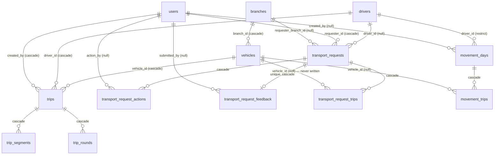

# Movement / Transportation System — Discovery Audit

> **Status update (2026-11-10):** The business has answered several of the open questions in §14:
> - Q1, Q11: no sub-system was adopted, and A is removed.
> - Q2: requests feed shared, scheduled trips.
> - Q3: the Movement Manager approves.
> - Q4: no branch isolation.
> - Q5: drivers may be linked to users.
>
> See [`movement-module-implementation-plan.md`](movement-module-implementation-plan.md). The findings below remain a valid description of the code as of this audit.

> **Scope:** Read-only source audit of everything related to transportation and vehicle movement (الحركة / النقل / المركبات / السائقون / الرحلات) in Zaha Core Orbit.
> **Date:** 2026-11-10 · **Branch audited:** `codex/add-ramadan-iftar-planning-details` (HEAD `b677f3f`)
> **Companion document:** [`movement-module-architecture-proposal.md`](movement-module-architecture-proposal.md)

## How to read this document

Every finding is tagged:

- **[VERIFIED]** — read directly from source in this repository (file + line given).
- **[INFERRED]** — a conclusion drawn from verified facts, or from third-party package behaviour that could not be read locally.
- **[UNVERIFIABLE]** — needs runtime data, production database access or business input.

Nothing was executed against a database. No migrations, seeders or tests were run. Row counts, production data volumes and which tables actually hold production data are therefore **[UNVERIFIABLE]**.

---

## 0. Executive summary

1. There is **no single movement system**. The repository contains **three parallel, unconnected transport sub-systems** built at different times, each with its own tables, controllers, views and role gates:

   | # | Sub-system | Tables | Built | Entry point (UI) | Gate |
   |---|---|---|---|---|---|
   | A | **Legacy fleet trips** | `trips`, `trip_segments`, `trip_rounds` | 2024-02 migrations | Sidebar → "الرحلات" | `role:transport_officer` |
   | B | **Transport requests ("Form 3")** | `transport_requests`, `transport_request_trips`, `transport_request_actions`, `transport_request_feedback` | 2026-02-13 | Only via `/dashboard/transport` launcher card | any authenticated user / `transport_officer` |
   | C | **Driver daily movements (الحركات)** | `movement_days`, `movement_trips` | 2026-03-09 | Sidebar → "الحركات" | `transport_officer\|movement_manager\|movement_editor\|movement_viewer\|super_admin` |

   Shared master data: `vehicles`, `drivers`.

2. The three sub-systems share no foreign keys with each other. A transport request is never turned into a trip or a movement day; there is no link between a "trip" (A) and a "movement" (C) even though they describe the same real-world event.
3. **No conflict prevention exists** for vehicles or drivers beyond one unique key (`movement_days(driver_id, date)`).
4. **No Spatie permissions exist for transport or movement.** All authorization is role-name based in `routes/web.php`. The movement roles only hold `agenda.view`.
5. **No branch isolation** applies to any transport route.
6. **Historical-data loss risk:** `users` and `branches` are hard-deleted (no `SoftDeletes` trait), and the FKs on transport tables use `cascadeOnDelete`. Deleting a user or a branch can permanently delete requests and trips.
7. The **Events module integration is one-way and loose**: Monthly activities record a "transport" execution need as JSON. `transport_officer` and `movement_manager` can secure or decline it. No transport record is created.

---

## 1. Repository search — classified findings

The search covered Arabic and English terms (`movement`, `transport`, `vehicle`, `driver`, `trip`, `dispatch`, `fleet`, `booking`, `reservation`, الحركة, النقل, المواصلات, المركبات, السائقون, الرحلات …).

### 1.1 Belongs to the Movement/Transport system [VERIFIED]

| Area | Files |
|---|---|
| Migrations | `database/migrations/2024_02_01_012000_create_vehicles_table.php`, `…012100_create_drivers_table.php`, `…012200_create_trips_table.php`, `…012300_create_trip_segments_table.php`, `…012400_create_trip_rounds_table.php`, `2026_02_13_0000070_create_transport_requests_table.php`, `…0000071_create_transport_request_trips_table.php`, `…0000072_create_transport_request_actions_table.php`, `…0000073_create_transport_request_feedback_table.php`, `2026_03_09_000012_create_movement_days_table.php`, `2026_03_09_000013_create_movement_trips_table.php` |
| Models | `app/Models/Vehicle.php`, `Driver.php`, `Trip.php`, `TripSegment.php`, `TripRound.php`, `TransportRequest.php`, `TransportRequestTrip.php`, `TransportRequestAction.php`, `TransportRequestFeedback.php`, `MovementDay.php`, `MovementTrip.php` |
| Controllers | `app/Http/Controllers/Web/Transport/{VehiclesController,DriversController,TripsController,MovementsController}.php`, `app/Http/Controllers/Roles/Transport/{TransportRequestsController,TripSegmentsController,TripRoundsController}.php`, `app/Http/Controllers/Roles/TransportOfficer/DashboardController.php`, `app/Http/Controllers/Web/Reports/TransportReportsController.php` |
| Routes | `routes/web.php:26,55-61,65,391-424,449` |
| Views | `resources/views/pages/transport/**` (14 files), `resources/views/roles/transport/requests/index.blade.php`, `resources/views/roles/transport_officer/dashboard.blade.php`, `resources/views/pages/reports/transport.blade.php` |
| JS | `public/assets/js/pages/pages-transport-movements-form.js` (+ `.min.js`) |
| Navigation | `resources/views/layouts/app.blade.php:63-66,234-239,247` |
| Translations | `resources/lang/{ar,en}/app.php` → `roles.transport.*`, `roles.transport_officer.*`, `roles.reports.transport.*`, `roles.super_admin.approvals.steps.transport.*` |
| Seeders | `database/seeders/MovementSeeder.php`, `RolesSeeder.php:90,93-95,257,264-266`, `UsersSeeder.php:70,73-75`, `DatabaseSeeder.php:32` |
| Role guide | `config/site_role_guide.php:20,23-25,112`, `app/Http/Controllers/SiteRoleGuideController.php:70,73-75,84,97` |

### 1.2 Integration points (other modules that reference transport) [VERIFIED]

| Location | Nature |
|---|---|
| `config/execution_needs.php:21` | Decision matrix: `'transport' => ['roles' => ['transport_officer','movement_manager']]` |
| `app/Modules/Events/Models/ExecutionNeedType.php:52,63,101,213,231` | Canonical execution-need `transport` and its legacy JSON fields |
| `app/Modules/Events/Models/MonthlyActivity.php:54,370` | Transport need definition; `needs_transport` flag |
| `app/Modules/Events/Http/Controllers/MonthlyActivities/MonthlyActivityPlanningController.php:48,321-327,884-890,2226-2279` | Validates and stores `transport_vehicles_count`, `transport_vehicle_type (bus\|car)`, `transport_passengers_count`, `transport_trip_direction (go_only\|round_trip\|return_only)`, `transport_start_from`, `transport_start_to` |
| `app/Modules/Events/Http/Controllers/MonthlyActivities/Concerns/InteractsWithMonthlyActivities.php:30-31,247-262` | `transport_officer` and `movement_manager` are in the monthly-activity **edit** role list; execution-need decision roles |
| `app/Modules/Events/Http/Controllers/MonthlyActivities/Concerns/InteractsWithMonthlyActivityApprovals.php:41` | Decision matrix consumer |
| `app/Modules/Events/Support/BazaarExecutionNeeds.php:37` | Icon for `transport` need |
| `app/Support/MonthlyActivityChangeValueFormatter.php:20,42,57,85-88,118,133` | Arabic labels for transport-need change logs |
| `routes/web.php:329-332,343` | `transport_officer`/`movement_manager` granted on monthly-activity show/edit/update/attachment-download routes |
| `app/Services/AdminReports/AdminReportsService.php:18,20,196,226` | `Vehicle::count()` and `Trip::count()` in super-admin reports |
| `app/Http/Controllers/Web/Reports/ReportsController.php:17` | Card for transport report in the reports hub |
| `app/Http/Controllers/Web/Access/ApprovalsController.php:25-26` | Static "transport approvals" description (lang only — not a workflow) |
| `database/seeders/PostExecutionShowcaseSeeder.php:149-150`, `RamadanIftarDemoSeeder.php:197` | Demo data containing a transport **need** (not transport records) |

### 1.3 False positives (not movement-related) [VERIFIED]

- `Booking`, `ZahaTimeBooking` (`app/Models/Booking.php`, `ZahaTimeBooking.php`) — venue/time bookings, unrelated to vehicles.
- `driver` in `KpiSql.php`, `Exceptions/Handler.php:70`, `2026_09_14_000100_generalize_existing_event_detail_tables.php:126-140` — **database** driver, not vehicle drivers.
- `config/{auth,cache,database,mail,queue,…}.php` — framework "driver" settings.
- `RamadanQaCleanup.php:40` — `stripos` false match.
- `fa-screwdriver-wrench` icons (maintenance).
- `docs/درايف سائقين نهائي.xlsx` — the business **driver schedule template** (source requirement for sub-system C, not code).

---

## 2. Database schema inventory

> Timestamps: every table below has `created_at`/`updated_at`. "Soft-delete column" means a `deleted_at` column exists in the schema; "Soft-delete active" means the model uses the `SoftDeletes` trait.

### 2.1 `vehicles` — master data
Migration `2024_02_01_012000_create_vehicles_table.php:11-20` [VERIFIED]

| Column | Type | Notes |
|---|---|---|
| `id` | bigint PK | |
| `plate_no` | string, nullable | No unique constraint |
| `vehicle_no` | string, nullable | No unique constraint. Used as display label |
| `status` | string, default `available` | Index `vehicles_status_idx`. UI values: `available`, `in_service`, `maintenance` (`pages/transport/vehicles/index.blade.php:37-39`). Server accepts any string ≤50 (`VehiclesController.php:32,55`) |
| `branch_id` | FK → `branches.id`, **cascadeOnDelete**, NOT NULL | Owning branch |
| `deleted_at` | soft-delete column | **Model does not use `SoftDeletes`** (`app/Models/Vehicle.php:8-10`) → column is dead |

- Not present: vehicle type or class, capacity, make or model, ownership, documents, licence or insurance expiry, odometer.
- Operational: yes.
- Writers: `VehiclesController@store/update`, `MovementSeeder`.
- Readers: Trips, Movements, Requests (driver only) forms, `AdminReportsService::overview`.

### 2.2 `drivers` — master data
`2024_02_01_012100_create_drivers_table.php:11-18` [VERIFIED]

| Column | Type | Notes |
|---|---|---|
| `id` | PK | |
| `name` | string | |
| `phone` | string, nullable | |
| `status` | string, default `active` | UI values `active`, `inactive` (`pages/transport/drivers/index.blade.php:37-38`). Server accepts any string |
| `deleted_at` | soft-delete column | **Model does not use `SoftDeletes`** |

- **No `user_id`**: drivers are not system users and cannot log in. There is no licence data, no branch and no availability calendar.
- Writers: `DriversController`, `MovementSeeder`.

### 2.3 `trips` — sub-system A (legacy fleet trip header)
`2024_02_01_012200_create_trips_table.php:11-24` [VERIFIED]

| Column | Notes |
|---|---|
| `trip_date` date | index `trips_trip_date_idx` |
| `day_name` string nullable | Free-text, typed manually |
| `driver_id` FK → drivers, **cascadeOnDelete**, NOT NULL | |
| `vehicle_id` FK → vehicles, **cascadeOnDelete**, NOT NULL | |
| `status` string default `scheduled` | index. UI values `scheduled`, `driver_view`, `closed` (create/edit) and `closed`, `completed` (close form) — `pages/transport/trips/edit.blade.php:38-40,227-228` |
| `notes` text | |
| `created_by` FK → users, **cascadeOnDelete** | |
| `deleted_at` | dead (no trait on `Trip`) |

- No branch column. `TransportReportsController.php:11` documents this explicitly.

### 2.4 `trip_segments` and `trip_rounds` — children of `trips`
`…012300…:11-21`, `…012400…:11-21` [VERIFIED]

The two tables are **structurally identical**:

| `trip_segments` | `trip_rounds` |
|---|---|
| `segment_no` | `round_no` |
| `location` | `location` |
| `team_companion` | `team` |
| `depart_time` | `start_time` |
| `return_time` | `end_time` |
| `notes` | `notes` |

- Both have `trip_id` with cascadeOnDelete. No unique `(trip_id, segment_no)`; the index is on `segment_no`/`round_no` alone.
- No soft deletes. Rows are hard-deleted through the UI.

### 2.5 `transport_requests` — sub-system B header
`2026_02_13_0000070…:3` [VERIFIED]

| Column | Notes |
|---|---|
| `requester_id` FK users **cascadeOnDelete** | |
| `requester_branch_id` FK branches nullOnDelete | Copied from `user->branch_id` at creation |
| `request_date` date, `day_name` string | |
| `driver_id` FK drivers nullOnDelete | Assigned by officer |
| `status` string default `pending` | index. Values written: `pending` (store), `in_review`, `approved`, `rejected`, `closed` (`TransportRequestsController.php:53,80`) |
| `movement_officer_notes`, `general_notes` text | |

- No soft deletes and no `deleted_at`.
- No vehicle on the header. The vehicle lives on the child trip.

### 2.6 `transport_request_trips`
`…0000071…:3` [VERIFIED]

- Columns: `transport_request_id` (cascade), `trip_no` tinyint default 1, `vehicle_id` FK nullOnDelete, `destination`, `accompanying_team`, `departure_time` time, `return_time` time.
- Index on `trip_no` only.
- **`vehicle_id` is never written by any controller.** `TransportRequestsController@store` (57-63) and `@process` (98-103) never set it, so vehicle assignment for requests is **not implemented**.
- The schema allows several trips per request, but code only ever creates and edits `trip_no = 1` and uses `trips()->first()` (`:96`).

### 2.7 `transport_request_actions` — audit trail for sub-system B
`…0000072…:3` [VERIFIED]

- Columns: `action_type` (indexed), `action_by` FK users nullOnDelete, `action_at` timestamp, `comment`.
- `action_type` values written: `created`, `in_review`, `approved`, `rejected`, `closed`, `feedback_submitted`.
- **This is the only movement-related history table.**

### 2.8 `transport_request_feedback`
`…0000073…:3` [VERIFIED]

- Columns: `transport_request_id` **unique** (cascade), `submitted_by` FK nullOnDelete, `punctuality_score`, `cleanliness_score`, `driver_behavior_score`, `overall_score` (tinyint 1–5, validated at `TransportRequestsController.php:121-124`), `comment`.
- At most one row per request. Writes use `updateOrCreate`.

### 2.9 `movement_days` — sub-system C header (driver × date)
`2026_03_09_000012…:3` [VERIFIED]

- Columns: `driver_id` FK drivers (**no onDelete → RESTRICT**), `date` (indexed), `notes`, `created_by` FK nullOnDelete.
- **Unique `(driver_id, date)`.** This is the only DB-level scheduling constraint in the whole system.
- No status column. Note that `roles.transport.movements.statuses` lang keys exist (`draft`, `submitted`, `approved`, …) but are unused.

### 2.10 `movement_trips`
`2026_03_09_000013…:3` [VERIFIED]

- Columns: `movement_day_id` (cascade), `vehicle_id` FK nullOnDelete, `destination`, `team`, `departure_time` time, `return_time` time.
- Index `movement_trips_day_idx`.
- No trip number. The order is insertion order.
- Rows are **deleted and recreated on every update** (`MovementsController.php:104-108`), so their IDs are not stable.

### 2.11 Supporting tables — fuel, maintenance, expenses, violations, accidents, insurance, licences, documents
**None exist for vehicles.** [VERIFIED by search]

- `maintenance_requests` exists but is a facilities maintenance system with no `vehicle_id`.
- `attachments` is not used by transport.
- `audit_logs`, `in_app_notifications` and `workflow_*` exist as shared infrastructure but are **not used by any transport code**.

### 2.12 Duplicate / overlapping structures [VERIFIED + INFERRED]

| Concept | A (legacy) | B (requests) | C (movements) |
|---|---|---|---|
| Daily header | `trips` (driver+vehicle+date) | `transport_requests` (requester+date+driver) | `movement_days` (driver+date) |
| Leg / destination | `trip_segments` **and** `trip_rounds` | `transport_request_trips` | `movement_trips` |
| Vehicle level | header | leg (never written) | leg |
| Driver level | header | header | header |
| Time fields | `depart_time/return_time` **and** `start_time/end_time` | `departure_time/return_time` | `departure_time/return_time` |
| Team | `team_companion` **and** `team` | `accompanying_team` | `team` |

[INFERRED] C (`movement_days`/`movement_trips`) mirrors the Excel driver schedule (`docs/درايف سائقين نهائي.xlsx`, described in `docs/deep-research-report.md:188`). A mirrors the earlier "trip + rounds" flowchart (`docs/deep-research-report.md:180`). `docs/comprehensive-change-plan.md:77-84` declared the intent to move "from traditional `trips` to request logic". That migration was never completed and A was never retired.

---

## 3. Models and relationships

### 3.1 Model inventory [VERIFIED]
All models live in `App\Models`. None have scopes, accessors, mutators, observers, events, enums, constants or traits beyond `HasFactory`. There are no factories for transport models (`database/factories` was not checked in depth; none referenced).

| Model | Relations (file:line) | Casts |
|---|---|---|
| `Vehicle` | `branch()` 19, `trips()` 24, `movementTrips()` 29 | — |
| `Driver` | `trips()` 18, `movementDays()` 23 | — |
| `Trip` | `driver()` 26, `vehicle()` 31, `creator()` 36, `segments()` 41, `rounds()` 46 | `trip_date: date` |
| `TripSegment` | `trip()` 27 | `depart_time/return_time: datetime:H:i` |
| `TripRound` | `trip()` 27 | `start_time/end_time: datetime:H:i` |
| `TransportRequest` | `requester()` 27, `branch()` 32, `driver()` 37, `trips()` 42, `actions()` 47, `feedback()` 52 | `request_date: date` |
| `TransportRequestTrip` | `request()` 22, `vehicle()` 27 | — (times stay raw strings) |
| `TransportRequestAction` | `request()` 24, `actor()` 29 | `action_at: datetime` |
| `TransportRequestFeedback` | `request()` 24, `submitter()` 29; `$table` override 12 | — |
| `MovementDay` | `driver()` 23, `trips()` 28, `creator()` 33 | `date: date` |
| `MovementTrip` | `movementDay()` 21, `vehicle()` 26 | — |
| `Branch` | `vehicles()` 58 | |
| `User` | `tripsCreated()` 166 | |

Missing inverse relations:
- `Driver::transportRequests()`
- `Vehicle::transportRequestTrips()`
- `User::transportRequests()`
- `Branch::transportRequests()`

### 3.2 Actual relationship map [VERIFIED from migrations + models]

What does **not** exist:
- `Users → Movement Requests → Vehicles → Drivers → Schedules → Trips` is **not** one chain in the implementation.
- Requests never produce schedules or trips.
- Schedules (`movement_days`) never reference requests.
- Drivers are not users.

---

## 4. Routes, controllers and business logic

All routes below sit inside `Route::middleware('auth')->group(...)` (`routes/web.php:135`). None of them use `branch.isolation`, `permission:` or policies. There are no AJAX/JSON endpoints. Every action is a classic form post with a redirect.

### 4.1 Route inventory [VERIFIED]

| # | Method | URI | Name | Controller@action | Middleware | Used by UI? |
|---|---|---|---|---|---|---|
| 1 | GET | `/dashboard/transport` | `role.transport_officer.dashboard` | `Roles\TransportOfficer\DashboardController@index` | `role:transport_officer` | **Not linked** from sidebar or main dashboard |
| 2 | GET | `/dashboard/transport/vehicles` | `role.transport.vehicles.index` | `Web\Transport\VehiclesController@index` | `role:transport_officer` | Sidebar |
| 3 | GET | `/dashboard/transport/vehicles/create` | `…vehicles.create` | `@create` | same | **Not linked** (index has an inline form) |
| 4 | POST | `/dashboard/transport/vehicles` | `…vehicles.store` | `@store` | same | yes |
| 5 | GET | `/dashboard/transport/vehicles/{vehicle}/edit` | `…vehicles.edit` | `@edit` | same | yes |
| 6 | PUT | `/dashboard/transport/vehicles/{vehicle}` | `…vehicles.update` | `@update` | same | yes |
| 7–11 | GET/GET/POST/GET/PUT | `/dashboard/transport/drivers[...]` | `role.transport.drivers.{index,create,store,edit,update}` | `Web\Transport\DriversController` | `role:transport_officer` | `create` **not linked** |
| 12 | GET | `/dashboard/transport/requests` | `role.transport.requests.index` | `Roles\Transport\TransportRequestsController@index` | **auth only** | Only from route #1 |
| 13 | POST | `/dashboard/transport/requests` | `…requests.store` | `@store` | **auth only** | yes |
| 14 | PATCH | `/dashboard/transport/requests/{transportRequest}/process` | `…requests.process` | `@process` | `role:transport_officer` + `abort_unless` (`:77`) | yes |
| 15 | PATCH | `/dashboard/transport/requests/{transportRequest}/feedback` | `…requests.feedback` | `@feedback` | auth + requester check (`:118`) | yes |
| 16–20 | GET/GET/POST/GET/PUT | `/dashboard/transport/trips[...]` | `role.transport.trips.{index,create,store,edit,update}` | `Web\Transport\TripsController` | `role:transport_officer` | `create` **not linked** |
| 21 | PATCH | `/dashboard/transport/trips/{trip}/close` | `…trips.close` | `@close` | same | yes (`trips/edit.blade.php:221`) |
| 22 | POST | `/dashboard/transport/trips/{trip}/segments` | `role.transport.segments.store` | `Roles\Transport\TripSegmentsController@store` | same | yes |
| 23 | PUT | `/dashboard/transport/segments/{tripSegment}` | `…segments.update` | `@update` | same | **No UI uses it** |
| 24 | DELETE | `/dashboard/transport/segments/{tripSegment}` | `…segments.destroy` | `@destroy` | same | yes |
| 25–27 | POST/PUT/DELETE | `…/trips/{trip}/rounds`, `…/rounds/{tripRound}` | `role.transport.rounds.{store,update,destroy}` | `Roles\Transport\TripRoundsController` | same | `update` **not used** |
| 28 | GET | `/dashboard/transport/movements` | `role.transport.movements.index` | `Web\Transport\MovementsController@index` | `role:transport_officer\|movement_manager\|movement_editor\|movement_viewer\|super_admin` | Sidebar |
| 29 | GET | `…/movements/create` | `…movements.create` | `@create` | same, **minus** `movement_viewer` | yes |
| 30 | POST | `…/movements` | `…movements.store` | `@store` | same as 29 | yes |
| 31 | GET | `…/movements/{movementDay}` | `…movements.show` | `@show` | same as 28 | yes |
| 32 | GET | `…/movements/{movementDay}/edit` | `…movements.edit` | `@edit` | same as 29 | yes |
| 33 | PUT | `…/movements/{movementDay}` | `…movements.update` | `@update` | same as 29 | yes |
| 34 | DELETE | `…/movements/{movementDay}` | `…movements.destroy` | `@destroy` | `role:transport_officer\|movement_manager\|super_admin` | yes |
| 35 | GET | `/dashboard/reports/transport` | `role.reports.transport.index` | `Web\Reports\TransportReportsController@index` | `role_or_permission:reports_viewer\|followup_officer\|super_admin\|reports.view` | Sidebar + reports hub |

Source lines: `routes/web.php:391-424` (1–34) and `:449` (35).

Naming inconsistencies:
- Controllers are split between `Web\Transport` and `Roles\Transport` namespaces.
- The route name prefix `role.transport.*` mixes "transport" and "movement".

### 4.2 Workflows as implemented

| # | Workflow | Exists? | Evidence |
|---|---|---|---|
| 1 | Create a movement request | **Yes (B)** | `TransportRequestsController@store:36-73` creates a header (status `pending`), a single trip leg and a `created` action. Any authenticated user can do this. Branch = `user->branch_id`. Hard-coded Arabic messages at lines 69 and 72 |
| 2 | Review / approve | **Partial (B)** | `@process:75-114`: the officer sets `status` ∈ {`in_review`,`approved`,`rejected`,`closed`} with **no transition guard**, so any status can move to any other, e.g. `closed → in_review`. There is a single actor and no multi-step approval. `ApprovalsController:25` and the lang `approvals.steps.transport` describe a 4-step flow (staff → transport officer → **programs manager** → transport officer) that is **not implemented** |
| 3 | Assign vehicle | A: yes, as trip header field. B: **No**, because `transport_request_trips.vehicle_id` is never written. C: yes, per leg | `TripsController:36`, `MovementsController:128` |
| 4 | Assign driver | A: header. B: yes, via `process` (`:92`). **Bug:** if the officer does not resend `driver_id`, it is reset to `null`. C: header | |
| 5 | Schedule a trip | A: `trips` with `trip_date`. C: `movement_days` per driver per date. B: request date only | |
| 6 | Check availability | **Missing everywhere.** Vehicle `status` and driver `status` are not consulted: dropdowns list all vehicles and drivers, including `maintenance` and `inactive` (`TripsController:16-17,24-25`, `MovementsController:51-52,87-88`, `TransportRequestsController:31`) | |
| 7 | Execute the trip | **Missing.** There is no actual departure/return capture, no odometer and no driver check-in | |
| 8 | Complete / return vehicle | A: `TripsController@close:90-105` sets the status to `closed` or `completed` (free string). B: officer sets `closed`. C: no status | |
| 9 | Cancel / reject | B: `rejected` via `process`. There is no requester-side cancel. A: no cancel status. C: hard delete (`MovementsController@destroy:114-119`) | |
| 10 | Edit / reschedule | A: `update`. B: the requester **cannot** edit; the officer can override destination and times on leg #1. C: full replace of legs (`:97-109`) | |
| — | Service feedback | **Yes (B)** | `@feedback:116-141`. The UI shows it only when status is `closed` (`requests/index.blade.php:145`) but **the server does not check status** |

No service classes, form requests or policies exist for transport. All validation is inline in controllers.

---

## 5. Roles, users and permissions

### 5.1 Roles [VERIFIED — `database/seeders/RolesSeeder.php`]

| Role key | name_ar | Line | Permissions granted (`:257,264-266`) |
|---|---|---|---|
| `transport_officer` | مسؤول النقل | 90 | `agenda.view` only |
| `movement_manager` | مدير الحركة | 93 | `agenda.view` only |
| `movement_editor` | محرر الحركة | 94 | `agenda.view` only |
| `movement_viewer` | مستعرض الحركة | 95 | `agenda.view` only |

**No permission named `transport.*`, `movement.*`, `vehicles.*` or `drivers.*` exists** in `RolePermissionSeeder.php`, `CompleteRolePermissionSeeder.php`, `KpiPermissionSeeder.php` or `BazaarRolePermissionSeeder.php`.

### 5.2 Authorization matrix [VERIFIED from route middleware + controller checks]

Legend: ✅ allowed · ❌ denied · ⚠️ allowed but inconsistent · — not implemented

| Role / user type | View | Create request | Approve request | Assign vehicle | Assign driver | Manage vehicles | Manage drivers | Manage schedules (movements) | Legacy trips | Reports |
|---|---|---|---|---|---|---|---|---|---|---|
| `super_admin` | Movements ✅; vehicles/drivers/trips ❌ **[INFERRED]**; own requests ✅ | ✅ | ❌ (`process` is `role:transport_officer`) | — | ❌ | ❌ **[INFERRED]** | ❌ **[INFERRED]** | ✅ incl. delete | ❌ **[INFERRED]** | ✅ |
| `transport_officer` | all ✅; requests = all branches | ✅ | ✅ (single step) | A,C ✅ / B — | ✅ | ✅ | ✅ | ✅ incl. delete | ✅ | ❌ unless also holds `reports.view` |
| `movement_manager` | Movements ✅; sidebar shows vehicles/drivers/trips → 403 ⚠️ | ✅ | ❌ | C ✅ | C ✅ | ❌ | ❌ | ✅ incl. delete | ❌ | ❌ |
| `movement_editor` | Movements ✅; sidebar 403s ⚠️ | ✅ | ❌ | C ✅ | C ✅ | ❌ | ❌ | create/edit ✅, delete ❌ (button still shown ⚠️) | ❌ | ❌ |
| `movement_viewer` | Movements list/show ✅; sidebar 403s ⚠️; Create/Edit/Delete buttons shown ⚠️ | ✅ | ❌ | ❌ | ❌ | ❌ | ❌ | ❌ | ❌ | ❌ |
| Any other authenticated user | own requests only (`TransportRequestsController:26-28`) | ✅ (route has no role gate) | ❌ | — | — | ❌ | ❌ | ❌ | ❌ | per `reports.view` |
| `reports_viewer` / `followup_officer` / `reports.view` holders | — | ✅ | ❌ | — | — | ❌ | ❌ | ❌ | ❌ | ✅ legacy `trips` list |
| Drivers (people) | — not system users — | | | | | | | | | |

**[INFERRED] super_admin denial:** `Gate::before` grants super_admin everything (`app/Providers/AuthServiceProvider.php:22-28`). However, the `role:` middleware alias resolves to Spatie's `RoleMiddleware` (`app/Http/Kernel.php:67`, aliased in `AppServiceProvider.php:39`). In spatie/laravel-permission **v6.25.0** (`composer.lock`) that middleware checks `hasAnyRole()` directly and does not consult the Gate. The `vendor/spatie` directory is **not present in this checkout**, so this could not be confirmed from local source. The sidebar (`layouts/app.blade.php:63-66,234-237`) shows these links to super_admin and movement_* roles. **Business confirmation is needed** on whether super_admin should manage the fleet.

### 5.3 Branch scope [VERIFIED]

- **No transport route uses `branch.isolation`** (compare `routes/web.php:259,276,428`).
- `transport_officer` sees **all** requests from all branches (`TransportRequestsController:26`).
- Vehicles have `branch_id`, but lists are not filtered by branch (`VehiclesController:14`).
- Drivers, trips and movement days have no branch at all, so they are organisation-wide.
- `EnforceBranchIsolation` (`app/Http/Middleware/EnforceBranchIsolation.php:18-19`) is keyed to agenda/monthly visibility only. It would not meaningfully scope transport even if applied.

### 5.4 Hard-coded role usage [VERIFIED]

- `TransportRequestsController.php:15,77`: `hasRole('transport_officer')`.
- `layouts/app.blade.php:64`: role list for the sidebar.
- `config/execution_needs.php:21`: decision roles for the `transport` execution need.
- `InteractsWithMonthlyActivities.php:30-31` and `routes/web.php:329-332,343`: `transport_officer` and `movement_manager` may **edit monthly activities**. This is cross-module privilege coupling that may be unintended — business must confirm.
- No hard-coded user IDs were found.

### 5.5 Demo users [VERIFIED — `UsersSeeder.php:24-35,70,73-75`]
`transport-officer@zaha.test`, `movement-manager@zaha.test`, `movement-editor@zaha.test`, `movement-viewer@zaha.test`, all with branch `amman`. The seeder upserts by email, **resets the password to `password`** and calls `syncRoles`.

---

## 6. Views, frontend and UX

### 6.1 Page inventory [VERIFIED]

| View | Purpose | Notes |
|---|---|---|
| `roles/transport_officer/dashboard.blade.php` | Launcher cards | The "Reports" card (`:22-26`) links to **drivers index**, not to reports. Unreachable from navigation |
| `pages/transport/vehicles/{index,create,edit}` | Vehicle CRUD | Index contains an inline create form duplicated in `create` (`index:24-56` vs `create`). Status is shown raw (`index:77`) |
| `pages/transport/drivers/{index,create,edit}` | Driver CRUD | Same duplication. Status is raw (`index:66`) |
| `pages/transport/trips/{index,create,edit}` | Legacy trips | Inline create duplicated. Edit (243 lines) holds the header, segments, rounds and close forms on one page. Status is raw (`index:93`) |
| `pages/transport/movements/{index,create,edit,show,form}` | Driver daily movements | Shared `form.blade.php` + `<template>` + `pages-transport-movements-form.js` for dynamic legs. Create/Edit/Delete buttons are not role-gated (`index:8,50-55`) |
| `roles/transport/requests/index.blade.php` | Requests: create form + list + officer process form + feedback form + action log | Single 202-line page, unpaginated. `action_type` is shown raw (`:182`) |
| `pages/reports/transport.blade.php` | Report | Lists only legacy `trips` (date + raw status) |

### 6.2 Findings
- **Reusable:** the movements `form.blade.php` with the template-row + JSON-hydration pattern; the `roles.partials.dashboard-actions` launcher partial.
- **Duplicated:** vehicles, drivers and trips each have an inline create form on the index **and** a separate create page.
- **Hard-coded statuses:** option lists are duplicated in the views (`vehicles/index:37-39`, `vehicles/create`, `drivers/*`, `trips/index:37-39`, `trips/create:27-29`, `trips/edit:38-40,227-228`, `requests/index:100-103`). There is no constants source.
- **Translations:**
  - `roles.transport.requests.statuses.pending` is **missing** in both `ar` and `en`. The view falls back to the raw key (`requests/index:84-85`).
  - `driver_view` (عرض السائق) is a trip status with no documented meaning.
  - Movement `statuses` keys exist without a status column.
  - Controller flash messages are hard-coded Arabic (`TransportRequestsController:69,72,113,137,140`).
- **Not linked from navigation:** routes #1, #3, #8, #17, #23, #26. The requests page (#12) is reachable only from the unlinked officer dashboard. **[INFERRED]** Ordinary staff cannot discover the request form without the URL.
- **Responsive:** Bootstrap grid classes are used (`col-12 col-md-*`). Requests and trips tables are wide and unpaginated. **[UNVERIFIABLE]** without rendering.
- **Dead or obsolete:** `segments.update` and `rounds.update` have no UI; `vehicles/create`, `drivers/create` and `trips/create` pages are not linked.

---

## 7. Calendar and scheduling audit

**There is no movement calendar.** [VERIFIED]

- No route, view or JS renders transport data on a calendar grid.
- Other modules use **server-rendered Blade month grids**, with no JS calendar library:
  - `MonthlyActivityCalendarController@calendar`
  - `BazaarController@calendar`
  - `pages/events/ramadan/calendar.blade.php`
- `flatpickr` is used for date inputs (`public/assets/js/agenda-events-index.js:393`).
- `resources/views/layouts new/Duralux-admin-1.0.0/apps-calendar.html` is an unused theme sample.

### 7.1 Conflict detection — current state

| Conflict | A (trips) | B (requests) | C (movements) |
|---|---|---|---|
| Same driver, same day | ❌ none | ❌ none | ✅ DB unique `(driver_id,date)` + validation (`MovementsController:125`) |
| Same vehicle, overlapping times | ❌ | ❌ | ❌ (across different drivers' days) |
| Same driver, overlapping legs | ❌ | ❌ | ❌ (legs inside one day are not checked) |
| `return_time` after `departure_time` | ❌ | ❌ | ❌ |
| Vehicle in `maintenance` / driver `inactive` | ❌ | ❌ | ❌ |
| Cross-system (A vs B vs C) | ❌ — the three systems are unaware of each other | | |

Additional findings:
- **Date/time:** time-only columns with a separate date and `config/app.php:71` timezone `UTC`. Overnight trips (return after midnight) cannot be represented. `day_name` is free text and is not derived from the date.
- The existing shared `App\Services\ConflictDetectionService` (58 lines) is hard-wired to `AgendaEvent` and `MonthlyActivity`, so it is not reusable as-is.

### 7.2 What a dedicated movement calendar would require [PROPOSAL — see architecture doc]
1. A single canonical assignment record with `starts_at`/`ends_at` datetimes.
2. Vehicle and driver availability, i.e. status plus time-off and maintenance blocks.
3. Overlap queries per vehicle and per driver.
4. Branch filtering, if business requires it.
5. A read-only month/week/day grid that reuses the existing Blade-grid approach.

---

## 8. Reports, dashboards and integrations

| Integration | Present? | Source / logic |
|---|---|---|
| Transport report page | Yes, minimal | `TransportReportsController:13-18`: `Trip::orderByDesc('trip_date')->get()`. **Legacy `trips` only.** No filters, no aggregation, no export. Ignores requests and movements |
| Reports hub card | Yes | `ReportsController.php:17` |
| Super-admin reports | Counts only | `AdminReportsService.php:196` `Vehicle::count()`; `:226` `Trip::count()` (legacy). Reached from `Roles\SuperAdmin\ReportsController` and `SiteSettingsController` |
| Main dashboard (`DashboardController`) | **No** | no transport references |
| KPI system (`app/Services/Kpi/**`, `routes/web.php:428-441`) | **No** | KPI modules are `agenda\|monthly\|ramadan\|bazaar` |
| Finance / maintenance reports | **No** | |
| User profiles / branch dashboards | **No** | |
| Notifications | **No** | `NotificationService` / `InAppNotification` are not called by transport code |
| Audit logs | **No** — only `transport_request_actions` for B | `AuditLog` is unused |
| Annual Agenda | **No direct link** | Movement roles get `agenda.view` only |
| Monthly activities / Ramadan / Bazaar | **Indirect** | The transport *need* is captured as JSON and decided by `transport_officer`/`movement_manager` (`config/execution_needs.php:21`). No transport request, trip or movement is generated |
| Exports | **None** | |
| KPI definitions for transport | **None** | |

---

## 9. Seeders and reference data

| Seeder | Movement effect | Classification |
|---|---|---|
| `MovementSeeder` (`DatabaseSeeder.php:32`) | Creates 4 drivers if **none** exist and 6 vehicles (`TRN-101…`) on the **first branch** if none exist. **Always** creates `movement_days` for the first 4 drivers for today and the previous 4 days (`firstOrCreate`) and random `movement_trips` where a day has none (`MovementSeeder.php:43-66`) | **Demo/test data — UNSAFE for production.** If production has drivers, it still inserts 5 days × 4 drivers of fake movement records with random vehicles and destinations, attributed to `User::value('id')`. **[INFERRED]** On a production DB, `firstOrCreate` avoids the unique `(driver_id,date)` error, so it silently reuses real days and adds random trips to any real day that has none |
| `RolesSeeder` | `updateOrCreate` the 4 roles; `givePermissionTo(['agenda.view'])` | Safe upsert, additive (`:53-56`). Its only revoke (`:64`) is unrelated (`ramadan_iftars.execute`) |
| `UsersSeeder` | Upserts the 4 demo users | **Potentially destructive** to any real account sharing these emails: resets the password and `syncRoles` (`:24-35`) |
| `RolePermissionSeeder`, `CompleteRolePermissionSeeder`, `KpiPermissionSeeder` | No transport permissions | — |
| `PostExecutionShowcaseSeeder:149-150`, `RamadanIftarDemoSeeder:197` | Transport *need* JSON on demo events | Demo |
| `rightDatabaseSeeder` | Event reference data, execution-need types, Ramadan reference, `CompleteRolePermissionSeeder` | No transport tables touched |

**Reference data:**
- Vehicle types, driver classifications and request types are absent.
- Movement statuses exist only as hard-coded strings and lang keys.

**Running `DatabaseSeeder` against production** would run `MovementSeeder` and `UsersSeeder`, both unsafe as described above. **Running `rightDatabaseSeeder` alone does not touch movement data.** [VERIFIED by reading the call lists; nothing was executed.]

---

## 10. Migration and historical data audit

Chronological order. All are **before** the protected cutoff `2026_09_10_000100_add_event_applicability_to_target_groups_table` (position 81 of 120). **None may be modified.**

| # | Migration | Creates | FKs | Indexes | `down()` |
|---|---|---|---|---|---|
| 1 | `2024_02_01_012000_create_vehicles_table` | `vehicles` | branch cascade | status | dropIfExists |
| 2 | `2024_02_01_012100_create_drivers_table` | `drivers` | — | status | dropIfExists |
| 3 | `2024_02_01_012200_create_trips_table` | `trips` | driver/vehicle/created_by cascade | trip_date, status | dropIfExists |
| 4 | `2024_02_01_012300_create_trip_segments_table` | `trip_segments` | trip cascade | segment_no | dropIfExists |
| 5 | `2024_02_01_012400_create_trip_rounds_table` | `trip_rounds` | trip cascade | round_no | dropIfExists |
| 6 | `2026_02_13_0000070_create_transport_requests_table` | `transport_requests` | requester cascade; branch, driver null | status | dropIfExists |
| 7 | `2026_02_13_0000071_create_transport_request_trips_table` | `transport_request_trips` | request cascade; vehicle null | trip_no | dropIfExists |
| 8 | `2026_02_13_0000072_create_transport_request_actions_table` | `transport_request_actions` | request cascade; action_by null | action_type | dropIfExists |
| 9 | `2026_02_13_0000073_create_transport_request_feedback_table` | `transport_request_feedback` | request cascade **unique**; submitted_by null | — | dropIfExists |
| 10 | `2026_03_09_000012_create_movement_days_table` | `movement_days` | driver **restrict**; created_by null | date; unique(driver_id,date) | dropIfExists |
| 11 | `2026_03_09_000013_create_movement_trips_table` | `movement_trips` | day cascade; vehicle null | movement_day_id | dropIfExists |

- No later migration alters any of these tables.
- `2026_09_16_000300_preserve_monthly_execution_need_catalogue.php:20` only references the `transport` execution-need code.
- **Naming anomaly:** migrations 6–9 use a 7-digit sequence (`0000070`), unlike the project's 6-digit convention. They sort correctly and are harmless, but must never be renamed.

### Historical-data risks [VERIFIED schema + INFERRED impact]

| Risk | Detail |
|---|---|
| **Hard delete of users** | `UsersController@destroy:174-178` calls `$user->delete()`, and `User` has no `SoftDeletes` even though `users.deleted_at` exists. DB cascades then **delete** the user's `transport_requests` (with legs, actions and feedback) and every legacy `trips` row they created (with segments and rounds). `movement_days.created_by` is nulled |
| **Hard delete of branches** | `BranchesController@destroy:50-52`, and `Branch` has no `SoftDeletes`. This cascade-deletes `vehicles`, which cascade-deletes legacy `trips`; `movement_trips.vehicle_id` and `transport_request_trips.vehicle_id` are nulled. **[UNVERIFIABLE]** Other restrict FKs on `branches` (e.g. `users.branch_id`) may block the delete in practice |
| Dead `deleted_at` columns | `vehicles`, `drivers`, `trips`. A future switch to `SoftDeletes` is safe and additive, but existing rows all have `NULL` |
| Unstable child IDs | `movement_trips` are deleted and re-created on every edit |
| Duplicate structures | `trip_segments` ≡ `trip_rounds`; three leg tables overall |
| Legacy vs current | **[UNVERIFIABLE]** Which of A, B and C holds real production data. Row counts are required before any consolidation decision |

---

## 11. Annual Agenda (and Events module) — architecture reference

**Important correction to the premise:** the "Annual Agenda module" is **not** a self-contained module. [VERIFIED]

| Concern | Where Agenda actually lives |
|---|---|
| Controllers | `app/Http/Controllers/Web/Agenda/AgendaEventsController.php` (1,349 lines), `AgendaApprovalsController.php` (299 lines) — **outside** `app/Modules` |
| Models | `app/Modules/Events/Models/AgendaEvent.php`, `AgendaApproval.php`, `AgendaParticipation.php`, `AgendaEventTarget.php`, `AnnualAgendaEditRequest.php`, `AnnualAgendaDeleteRequest.php` |
| Services | `app/Services/AgendaWorkflowBridgeService.php`, `AgendaWorkflowPresenter.php`, `ConflictDetectionService.php`, `DynamicWorkflowService.php` (728 lines), `PlanChangeRequestWorkflowService.php`, `NotificationService.php`, `WorkflowNotificationService.php` |
| Routes | `routes/web.php:242-256`, inline in the monolithic file, with `role_or_permission:` + `agenda.*` permissions + `branch.isolation` |
| Views | `resources/views/pages/agenda/{events,approvals}` |
| Permissions | `agenda.view/create/update/delete/approve/participation.update` (`RolePermissionSeeder.php:13-18`) |
| Branch scoping | `User::hasBranchScopedAgendaVisibility()` (`User.php:76`), `scopedBranchIds()` (`:99`), controller-level `applyBranchVisibilityScope` (`AgendaEventsController:321`) |
| Approval | Generic `workflows` / `workflow_steps` / `workflow_instances` / `workflow_logs` engine keyed by `module` (`WorkflowSeeder.php:115` `agenda`, `:153` `monthly_activities`, `:217` `ramadan_iftars`) |
| Audit | `AuditLog` (`user_id, action, module, entity_type, entity_id, old_values, new_values`), `WorkflowLog` |
| Calendar | Agenda list with flatpickr filters; month grids for Monthly/Bazaar/Ramadan |

**The closest real precedent for a self-contained module** is the newer `app/Modules/Events` sub-areas, for example Bazaar:
- `app/Modules/Events/Http/Controllers/Bazaar/BazaarController.php`
- `Http/Requests/Bazaar/StoreBazaarRequest.php`
- `Models/Bazaar.php` with `STATUS_*` constants and `STATUSES` (`:11-20`)
- `Support/BazaarExecutionNeeds.php`
- a module-owned additive permission seeder, `database/seeders/BazaarRolePermissionSeeder.php`, which uses `updateOrCreate` + `givePermissionTo` and never revokes
- route group `prefix('dashboard/events/bazaars')->name('events.bazaars.')->middleware('branch.isolation')` (`routes/web.php:259`)

### Patterns suitable for Movement
- Namespace under `app/Modules/<Name>` with `Http/Controllers`, `Http/Requests`, `Models`, `Services`, `Support`. This is autoloaded by the existing `App\\` PSR-4 root (`composer.json:25-26`), so no provider is needed.
- Status constants on the model (Bazaar).
- Additive, module-owned permission seeder (Bazaar).
- `module`-scoped `AuditLog` entries.
- Optional: the `DynamicWorkflowService` engine, if multi-step approval is required.

### Patterns to avoid copying
- 1,300-line controllers.
- Controllers outside the module.
- Coupling to `AgendaEvent`/`MonthlyActivity` inside shared services (`ConflictDetectionService`).
- Agenda-specific visibility helpers on `User`.

---

## 12. Technical debt and issues

| ID | Severity | Issue | Evidence |
|---|---|---|---|
| T-01 | **Critical** | Deleting a user hard-deletes their transport requests, legacy trips and children through cascade FKs; history is lost permanently | `2026_02_13_0000070…` (`requester_id` cascade), `2024_02_01_012200…:19`, `UsersController.php:178`, `User.php` (no SoftDeletes) |
| T-02 | **Critical** | Deleting a branch cascade-deletes vehicles and then legacy trips | `2024_02_01_012000…:16`, `…012200…:16`, `BranchesController.php:52` |
| T-03 | **High** | No vehicle or driver double-booking prevention (except driver/day in C) | §7.1 |
| T-04 | **High** | Three parallel, unlinked transport data models; reports read only the legacy one | §0, §2.12, `TransportReportsController.php:15` |
| T-05 | **High** | Request status has no state machine: any status can go to any status; the officer can reopen closed or rejected requests | `TransportRequestsController.php:80-94` |
| T-06 | **High** | `process` resets `driver_id` to null when it is omitted | `TransportRequestsController.php:92` |
| T-07 | **High** | No permissions model; role-name gates only; super_admin likely locked out of fleet pages while the sidebar shows them | §5.2 |
| T-08 | **High** | No branch isolation on any transport route; the officer sees every branch's requests | §5.3 |
| T-09 | **High** | `MovementSeeder` in `DatabaseSeeder` writes fake movement days unconditionally | `MovementSeeder.php:43-66`, `DatabaseSeeder.php:32` |
| T-10 | Medium | Vehicle assignment for requests not implemented (`transport_request_trips.vehicle_id` never written) | `TransportRequestsController.php:57-63,98-103` |
| T-11 | Medium | Feedback accepted in any status (UI-only guard) | `TransportRequestsController.php:116-131` vs `requests/index.blade.php:145` |
| T-12 | Medium | Unvalidated free-string statuses for vehicles, drivers and trips | `VehiclesController:32`, `DriversController:28`, `TripsController:37,93` |
| T-13 | Medium | No audit history for vehicles, drivers, trips or movements; movement deletes are hard and untracked | `MovementsController.php:114-119` |
| T-14 | Medium | `movement_trips` deleted and recreated on every update (unstable IDs, lost `created_at`) | `MovementsController.php:104-108` |
| T-15 | Medium | Unpaginated full-table loads: trips index, requests index (5 eager relations), vehicles, report | `TripsController:15`, `TransportRequestsController:30`, `VehiclesController:14`, `TransportReportsController:15` |
| T-16 | Medium | Movement roles can edit monthly activities (cross-module privilege) | `InteractsWithMonthlyActivities.php:30-31`, `routes/web.php:330,332` |
| T-17 | Medium | `SoftDeletes` columns present but traits missing on `Vehicle`, `Driver`, `Trip` | models vs migrations |
| T-18 | Medium | No `return_time > departure_time` validation; time-only columns; no overnight support; free-text `day_name` | all three subsystems |
| T-19 | Medium | `UsersSeeder` resets passwords and roles of demo-email accounts | `UsersSeeder.php:24-35` |
| T-20 | Low | Request validation rule built by string-concatenating raw `driver_id` input | `MovementsController.php:125` |
| T-21 | Low | Hard-coded Arabic flash messages; missing `pending` translation | `TransportRequestsController.php:69,72,113,137,140` |
| T-22 | Low | Duplicate inline create forms + separate create pages; dead routes (`segments.update`, `rounds.update`, `*.create`) | §6.2 |
| T-23 | Low | Officer dashboard "Reports" card links to drivers; dashboard unreachable from navigation | `transport_officer/dashboard.blade.php:22-26` |
| T-24 | Low | `trip_segments` ≡ `trip_rounds` duplication; no unique `(trip_id, *_no)` | §2.4 |
| T-25 | Low | Movement viewers and editors see buttons they cannot use | `movements/index.blade.php:8,50-55` |
| T-26 | Low | No tests cover transport or movement (`tests/` contains none) | `tests/Feature/*` |
| T-27 | Low | Strict `===` between `auth()->id()` and `requester_id` in the view may misbehave if the PDO driver returns strings | `requests/index.blade.php:145` |

**N+1:** list pages eager-load correctly. `movements/index` uses `$day->trips->count()` on an eager-loaded relation, which is fine; `withCount` would be lighter.

---

## 13. What could not be verified

1. Production row counts per table, and therefore **which sub-system (A, B or C) is actually in use**.
2. Whether production contains `*@zaha.test` users or `MovementSeeder` demo rows.
3. The Spatie `RoleMiddleware` behaviour toward super_admin (the vendor package is absent locally).
4. Whether other FKs block branch deletion in practice.
5. Real business meaning of the trip status `driver_view`, and of "segments" versus "rounds".
6. Rendered UI and mobile behaviour.
7. The content of `docs/درايف سائقين نهائي.xlsx` and the Form 3 source documents (binary files, not parsed).

## 14. Open business questions

1. Which sub-system is the system of record today: A, B, C, or a mix?
2. Is a "movement" a **request-driven** service (B) or an **officer-planned driver schedule** (C), or both, with requests feeding schedules?
3. Who approves transport requests? The lang file describes a 4-step flow with **programs_manager** confirmation; the code has a single step.
4. Are vehicles and drivers organisation-wide or branch-owned? Should branch users see only their branch's requests?
5. Should drivers become system users, for example to view their own schedule?
6. Should super_admin manage the fleet?
7. Should `transport_officer`/`movement_manager` keep monthly-activity edit rights?
8. What is the difference between `transport_officer` and `movement_manager`?
9. Should a monthly-activity "transport" need automatically create a transport request?
10. Are fuel, maintenance, licence and insurance tracking in scope?
11. What should happen to legacy `trips`/`trip_segments`/`trip_rounds` data: keep it read-only, migrate it, or archive it?
